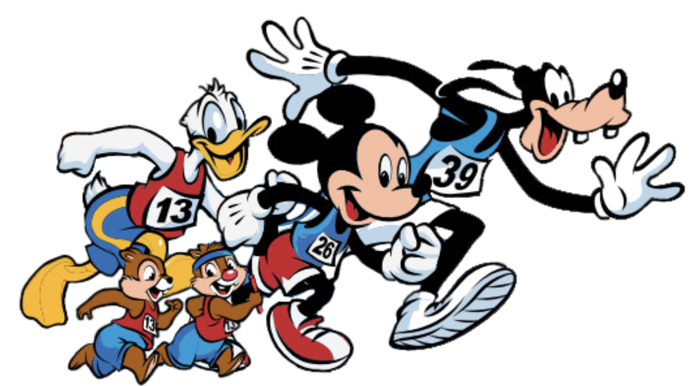
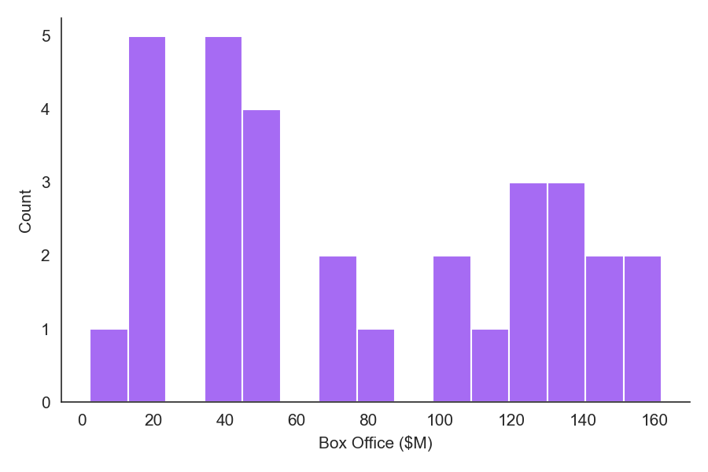
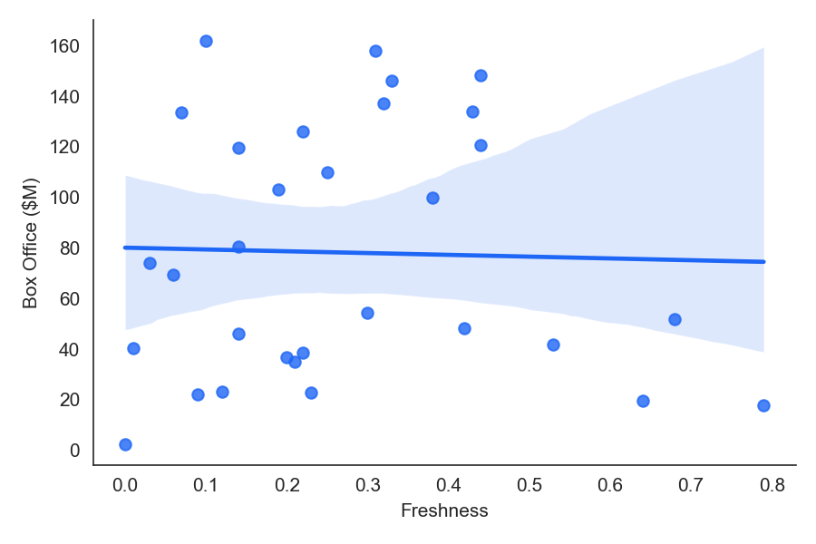

# Scales of Measurement

{width=70%}

---

## Four scales

- **Nominal** — categories, no order
- **Ordinal** — categories, ordered, unequal gaps
- **Interval** — ordered, equal gaps, no true zero
- **Ratio** — ordered, equal gaps, true zero

---

## Properties of each scale

| Scale | Categories | Ordered | Equal intervals | True zero | Examples |
|---|:---:|:---:|:---:|:---:|---|
| Nominal | ✓ | | | | Eye color, movie title, gender |
| Ordinal | ✓ | ✓ | | | Race finish place, Likert agreement |
| Interval | ✓ | ✓ | ✓ | | Year, temperature (°C) |
| Ratio | ✓ | ✓ | ✓ | ✓ | Box office ($), reaction time |

[@TheoryScalesMeasurement2026]

---

## What each scale allows

| Scale | Permissible statistics |
|---|---|
| Nominal | Number of cases, mode, contingency correlation |
| Ordinal | Median, percentiles |
| Interval | Mean, standard deviation, rank-order correlation, product-moment correlation |
| Ratio | Coefficient of variation |

[@TheoryScalesMeasurement2026]

---

## Rotten Tomatoes data

```python
import pandas as pd

base = "https://raw.githubusercontent.com/ethanweed/"
path = "datasets-for-teaching/main/JASP_data_library/"
file = "4.%20Regression/Adam%20Sandler.csv"

df = pd.read_csv(base + path + file)
df.head()
```

---

## Rotten Tomatoes data

| Year | Freshness | Box Office ($M) | Movie Title |
|---|---|---|---|
| 2000 | 0.22 | 38.5 | Little Nicky |
| 2001 | 0.30 | 54.4 | The Animal |
| 2002 | 0.22 | 126.2 | Mr. Deeds |
| 2002 | 0.01 | 40.3 | The Master of Disguise |
| 2002 | 0.21 | 34.9 | The Hot Chick |

---

# Descriptive Stats

---

## Counts (nominal)

```python
df["Movie Title"].value_counts()
```

```
Movie Title
Little Nicky                       1
The House Bunny                    1
Blended                            1
Grown Ups 2                        1
That's My Boy                      1
Hotel Transylvania                 1
Bucky Larson: Born to Be a Star    1
Jack and Jill                      1
Name: count, dtype: int64
```

---

## Central tendency

```python
df["Box Office ($M)"].mean()
df["Box Office ($M)"].median()
df["Box Office ($M)"].mode()
```

```
mean:   78.21
median: 69.30
mode:   [2.3, 17.8, 19.7, ... ]  # all 31 values — nothing repeats
```

---

## Spread

```python
df["Box Office ($M)"].std()
df["Box Office ($M)"].var()

mad = (df["Box Office ($M)"] - df["Box Office ($M)"].median()).abs().median()
```

```
std: 49.59
var: 2459.46
mad: 46.00
```

---

## Visualizing the distribution

```python
import seaborn as sns

sns.histplot(df["Box Office ($M)"], bins=15)
sns.despine()
```

{width=55%}

---

## Correlation

```python
sns.regplot(data=df, x="Freshness", y="Box Office ($M)")
sns.despine()

df["Freshness"].corr(df["Box Office ($M)"])
```

:::::: {.two-col}

::: {}
{width=90%}
:::

::: {}
```
r = -0.029
```
:::

::::::

---

## Glasgow Norms

```python
base = "https://raw.githubusercontent.com/ethanweed/"
path = "datasets-for-teaching/main/JASP_data_library/"
file = "4.%20Regression/Glasgow%20Norms.csv"

df = pd.read_csv(base + path + file)
```

1. How gendered are words on average?
2. How certain are you about your answer?
3. Are male or female words seen as more positive?
4. Anything that should be qualified in your answers?

---

## References {.scrollable}

::: {#refs}
:::

