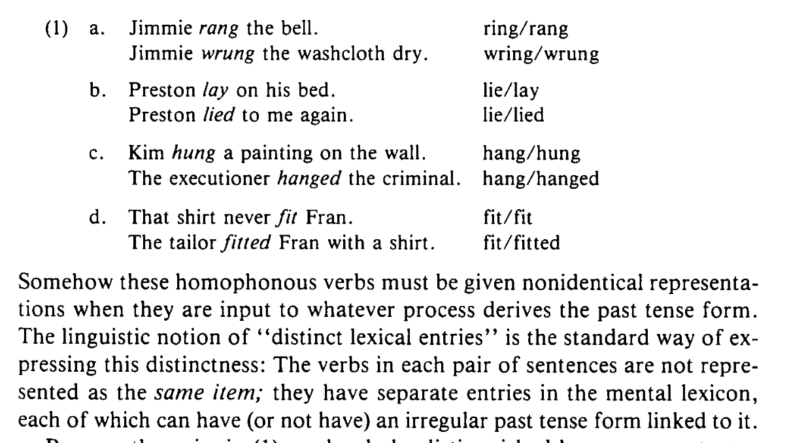
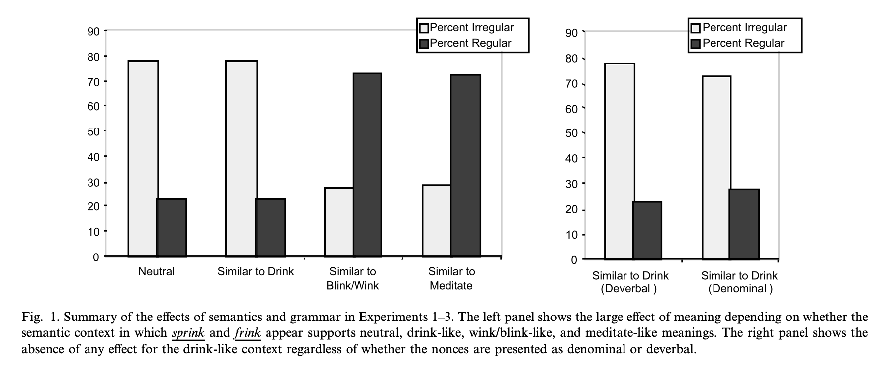

# Dual-route vs. single-route models


## Single-route model

When forming the past tense...

- Connectionist networks can correctly inflect verbs
- No rules needed
- Network learns the correct weights

[@rumelhartMcclelland1986]

## Dual-route model

When forming the past tense...

- Phonological analogy helps
- Grammatical knowledge is essential
- Homophones demostrate this

[@pinkerLanguageConnectionism; @kimWhyNoMere1991]

## Homophone problem



[@pinkerLanguageConnectionism; @kimWhyNoMere1991]

## The dual-route model

```{=html}
<iframe src="dual_route_demo.html" style="width:100%; height:560px; border:1px solid var(--ctp-surface2); border-radius:10px; background:white;"></iframe>
```


## The single-route (connectionist) model

```{=html}
<iframe src="PDP_single_route_demo.html" style="width:100%; height:560px; border:1px solid var(--ctp-surface2); border-radius:10px; background:white;"></iframe>
```


# Semantics?

## Can meaning influence inflection?

- Single-route theorists say "no"
- Dual-route theorists say "yes"

Ramscar (2002) is going to find out...

## Experiment 1 — Order effects

- pseudoword-inflection task: participants saw an inflected example of a
  **different, phonologically unrelated** pseudoword immediately before producing
  their own
- Tests whether repeated-measures designs secretly bias later responses

## Experiment 1 — Example stimulus

```{=html}
<div class="stim-cards">
<div class="stim-card"><span class="cond-label">Example card — irregular condition</span>Every Wednesday, John likes to <em>frow</em>. Last week, John <strong>frew</strong> a lot.</div>
<div class="stim-card"><span class="cond-label">Example card — regular condition</span>Every Wednesday, John likes to <em>frow</em>. Last week, John <strong>frowed</strong> a lot.</div>
<div class="stim-card stim-target"><span class="cond-label">Target card</span>Every Friday, Sam likes to <em>sprink</em>. Last week, Sam <strong>________</strong> a lot.</div>
</div>
```


## Experiment 1 — Order effects

- **Finding:** a regular example pulled later responses toward regular forms —
  a genuine order effect, independent of phonology
- **Conclusion:** collect only one data point per participant in every experiment
  that follows

## Experiment 2 — Does meaning affect inflection?

- The same pseudoword (*sprink* / *frink*) embedded in three semantic contexts:
  drink-like, blink/wink-like, or an unrelated regular (*meditate*-like)
- Phonological similarity to existing verbs held constant across conditions

## Experiment 2 — Example stimulus

```{=html}
<div class="stim-cards">
<div class="stim-card"><span class="cond-label">Drink-priming context</span>In a traditional spring rite at Moscow University Hospital, the terminally ill patients all <em>frink</em> in the onset of good weather, consuming vast quantities of vodka and pickled fish. In 1996, his favorite vodka glass in hand, cancer patient Ivan Borovich <strong>________</strong> around 35 vodka shots and 50 pickled sprats...</div>
</div>
```

Matched regular-priming (blink/wink-like) and meditate-like versions held the
surrounding sentence frame phonologically identical.

## Experiment 2 — Does meaning affect inflection?

- **Finding:** meaning shifted inflection — drink-like context → mostly
  irregular; blink/wink-like or meditate-like context → mostly regular
- **Conclusion:** Semantic similarity can resolve the "homophone problem" dual-route theory
  says requires a grammatical rule

## Experiment 3 — Grammar vs. semantics

- Same pseudowords now introduced as **denominal** verbs (derived from a noun) —
  the grammatical-analysis hypothesis predicts automatic regularization,
  regardless of meaning or sound
- Independently verified: participants *did* perceive the pseudowords as denominal

## Experiment 3 — Example stimulus

```{=html}
<div class="stim-cards">
<div class="stim-card"><span class="cond-label">Denominal, drink-priming context</span>A <em>frink</em> is the Muscovite equivalent of the Spanish tapas; it is served in bars, and usually comprises chilled vodka and some salted or pickled fish. In a traditional spring rite at Moscow University Hospital, the terminally ill patients all <em>frink</em> in the onset of good weather... cancer patient Ivan Borovich <strong>________</strong> around 35 vodka shots and 50 pickled sprats...</div>
</div>
```

Same drink-priming passage as Experiment 2, with a sentence added up front
that introduces *frink* as a noun first — making the verb denominal.

## Experiment 3 — Grammar vs. semantics

- **Finding:** when context still pointed toward *drink*, participants
  inflected irregularly anyway — denominal status didn't override meaning
- **Conclusion:** Grammar alone doesn't predict the pattern; semantic priming does

## Experiment 4 — Re-testing Kim et al. (1991)

- Re-ran Kim et al.'s past-tense acceptability study, but had **naive
  raters** — not the experimenters — independently judge each verb as
  denominal or deverbal
- Also re-measured "semantic reminding" as similarity *to* the irregular,
  not distance *from* it

## Experiment 4 — Example stimulus

```{=html}
<div class="stim-cards">
<div class="stim-card"><span class="cond-label">Existing denominal</span>Wade Boggs has a bad habit of hitting <em>fly</em> balls and getting caught... In yesterday's game, I saw him <em>fly out</em> four times. I swear he cost us the game.</div>
<div class="stim-card"><span class="cond-label">Metaphorical deverbal</span>Tim has a terrible temper. No-one knows when next he will <em>fly off</em> the handle...</div>
<div class="stim-card"><span class="cond-label">Central / typical use</span>Birds <em>fly</em> south in winter.</div>
</div>
```


## Experiment 4 — Re-testing Kim et al. (1991)

- **Finding:** semantic reminding strongly predicts acceptability; once
  measured independently, grammatical origin does not
- **Conclusion:** The original "grammar beats semantics" result depended on the
  experimenters' own, semantically-confounded classifications

## Experiment 5 — "Fly out": memory vs. rule

- British vs. American speakers inflect the baseball term *fly out*, a
  denominal verb in both dialects
- Dual-route prediction: same grammatical analysis everywhere → same regular
  form everywhere

## Experiment 5 — Example stimulus

```{=html}
<div class="stim-cards">
<div class="stim-card stim-target">On an analogy with birds flying, in baseball a <em>fly</em> is a ball that is hit high into the air and is easily caught. It follows then that <em>to fly out</em>, if you are a batter, is to hit a fly and get caught, as in "In the last innings of the big game against the Syracuse Swifts this year, Jim Crow of the Baltimore Blasters <strong>________</strong> just when his team needed a home run from him."</div>
</div>
```

British participants were largely unfamiliar with this expression going in, making this a sort of real-world pseudoword.

## Experiment 5 — "Fly out": memory vs. rule

- **Finding:** Americans (who know the convention) mostly said *flied out*;
  Brits (unfamiliar with it) mostly said *flew out*
- **Conclusion:** The past-tense form tracked **cultural/memory exposure**, not grammatical
  category

## Ramscar's main results (experiments )



[@ramscar2002]

## Putting semantics into the single-route model

```{=html}
<iframe src="PDP_single_route_semantic_demo.html" style="width:100%; height:560px; border:1px solid var(--ctp-surface2); border-radius:10px; background:white;"></iframe>
```


# References

## References {.scrollable}

::: {#refs}
:::
