# Language Parsing as Prediction

## Predictive coding

:::: {.columns}
::: {.column width="50%"}
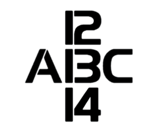
:::
::: {.column width="50%"}
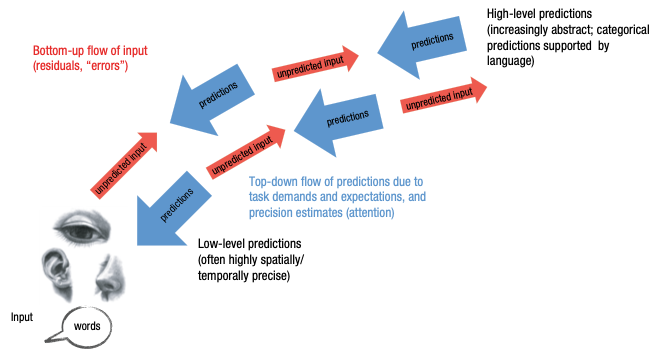
:::
::::

[@lupyanWordsWorldPredictive2015]

## Connectionism

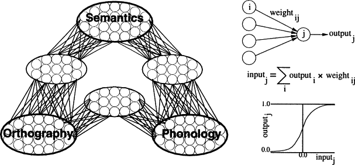

[@plautCognitiveFunctionsNormal2001]

# N400s and ERPs

## EEG

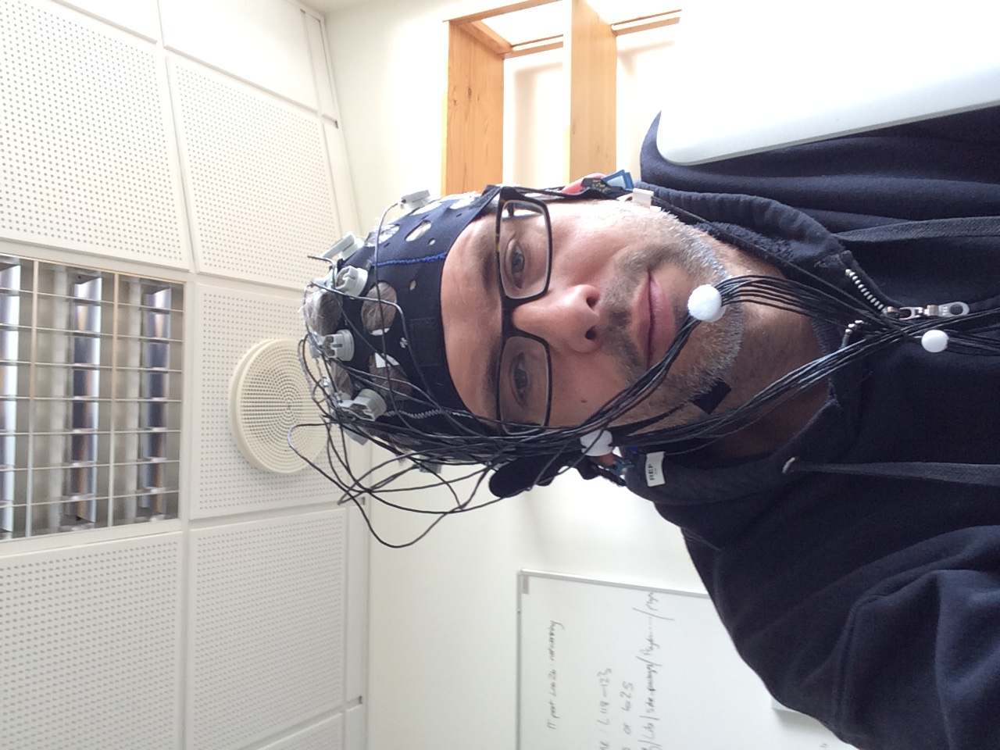

## EEG

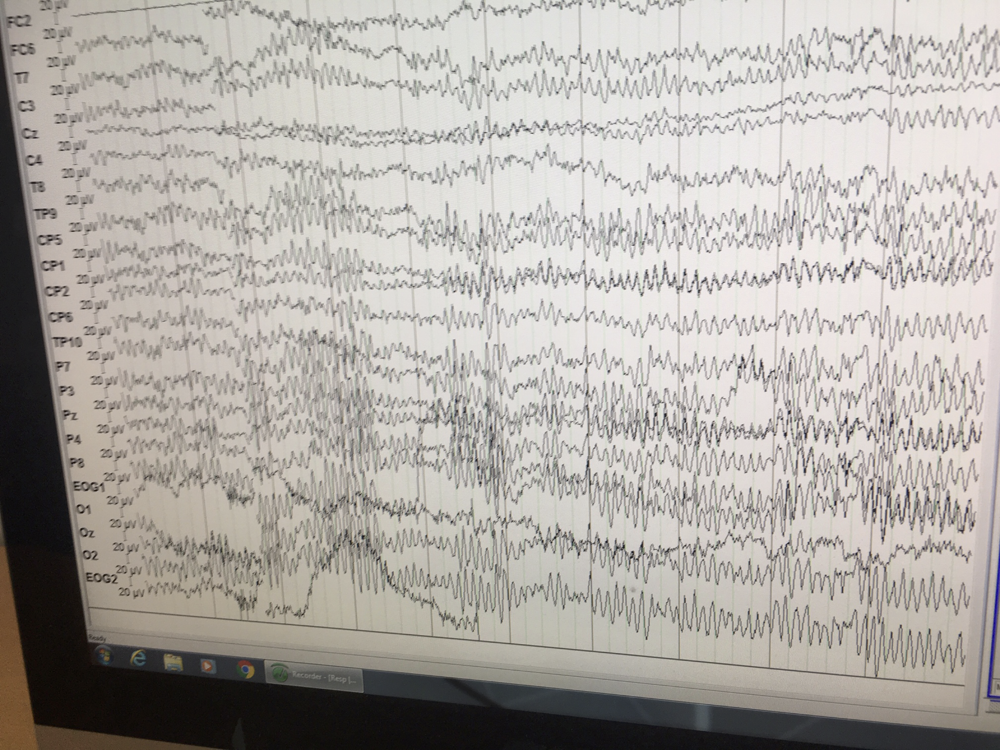

## Stimuli

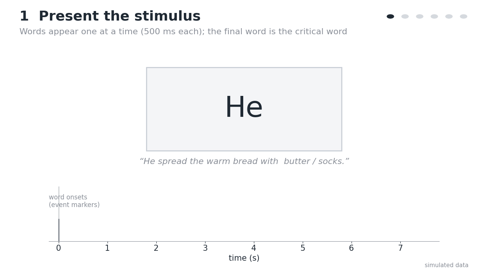{data-replay=""}

Animation created with Claude Code (Anthropic, Claude Opus 5.5)

## Raw data

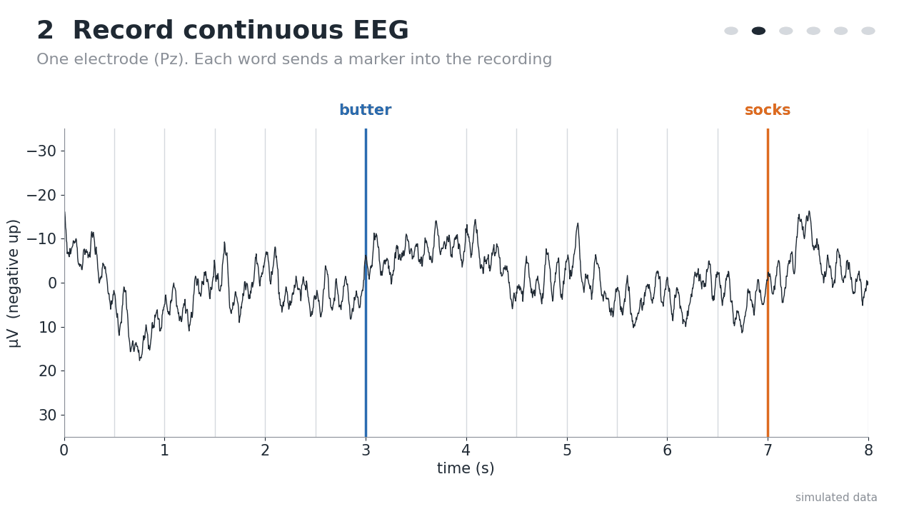{data-replay=""}

Animation created with Claude Code (Anthropic, Claude Opus 5.5)

## Epoching

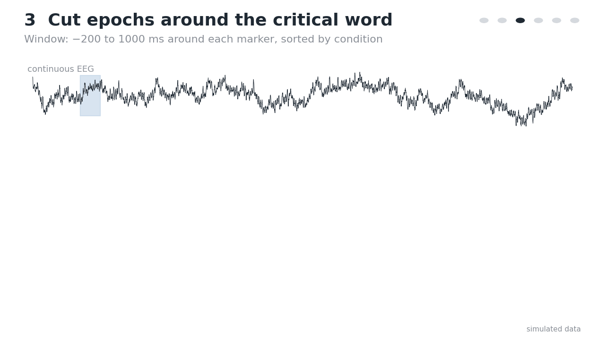{data-replay=""}

Animation created with Claude Code (Anthropic, Claude Opus 5.5)

## Averaging

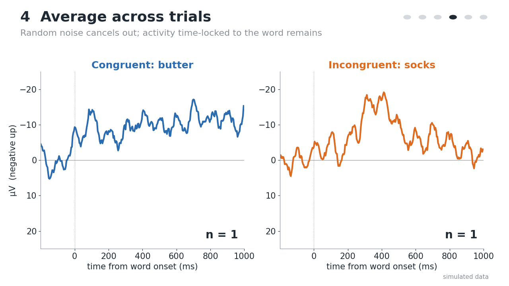{data-replay=""}

Animation created with Claude Code (Anthropic, Claude Opus 5.5)

## Comparison

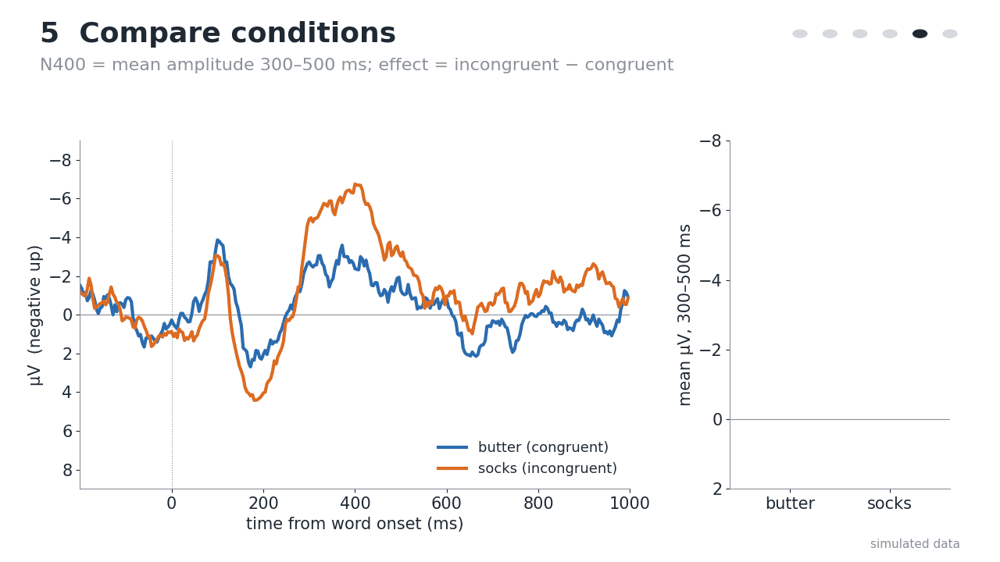{data-replay=""}

Animation created with Claude Code (Anthropic, Claude Opus 5.5)

## Scalp maps

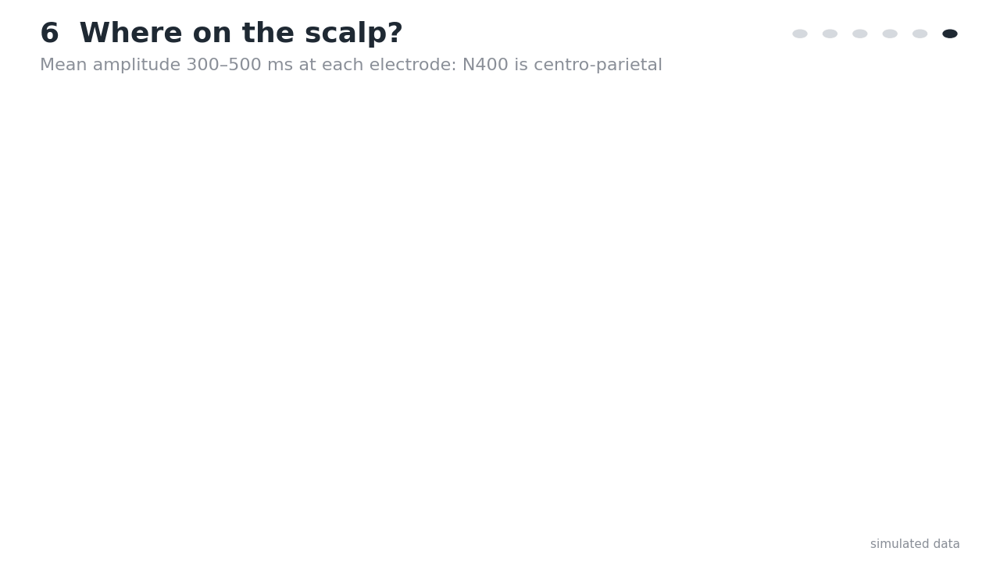{data-replay=""}

Animation created with Claude Code (Anthropic, Claude Opus 5.5)

# DeLong et al (2005)

## N400s: Prediction or Integration?

[@delongProbabilisticWordPreactivation2005]

## Cloze probability

- "The day was breezy, so the boy went outside to fly ___"
- "The day was breezy, so the boy went outside to fly a/an ___"

Cloze probabilities from 0 - 96 (article)/100 (noun)%

[@delongProbabilisticWordPreactivation2005]

## N400s

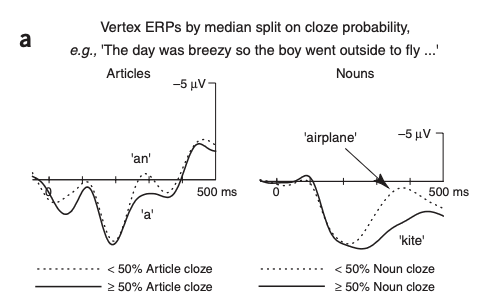

[@delongProbabilisticWordPreactivation2005]

## Correlation with Cloze

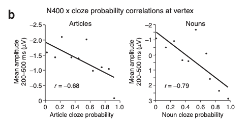

[@delongProbabilisticWordPreactivation2005]

## Scalp maps

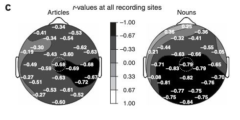

[@delongProbabilisticWordPreactivation2005]

# Integrating Prediction and Connectionism

## Prediction


[@plautCognitiveFunctionsNormal2001]

## Prediction

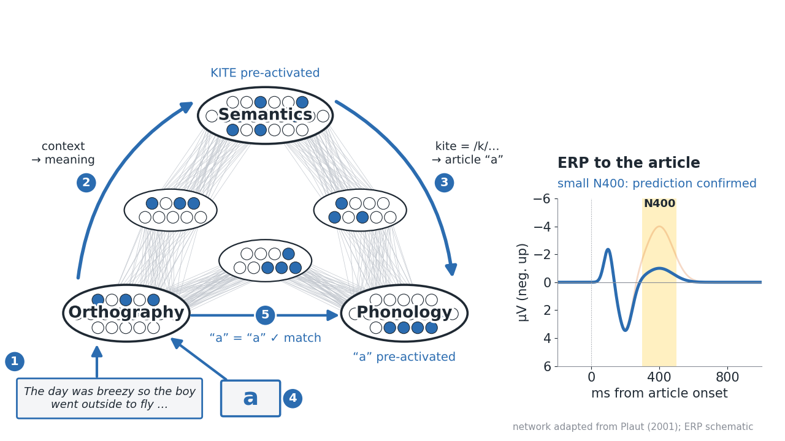

adapted from [@plautCognitiveFunctionsNormal2001]

Animation created with Claude Code (Anthropic, Claude Opus 5.5)

## Prediction Error

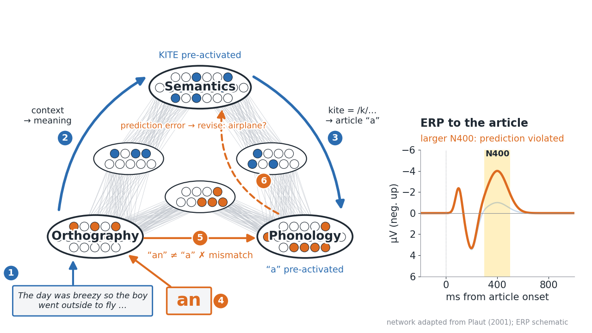

adapted from [@plautCognitiveFunctionsNormal2001]

Animation created with Claude Code (Anthropic, Claude Opus 5.5)

# References

## References {.scrollable}

::: {#refs}
:::

```{=html}
<script>
// Restart play-once GIFs each time their slide is entered.
window.addEventListener('load', () => {
  const gifs = new Map();
  document.querySelectorAll('img[data-replay]').forEach(img => gifs.set(img, img.src));
  async function replay(slide) {
    for (const img of slide.querySelectorAll('img[data-replay]')) {
      const blob = await (await fetch(gifs.get(img))).blob();
      if (img.dataset.blobUrl) URL.revokeObjectURL(img.dataset.blobUrl);
      img.dataset.blobUrl = URL.createObjectURL(blob);
      img.src = img.dataset.blobUrl;
    }
  }
  Reveal.on('slidechanged', e => replay(e.currentSlide));
  replay(Reveal.getCurrentSlide());
});
</script>
```
