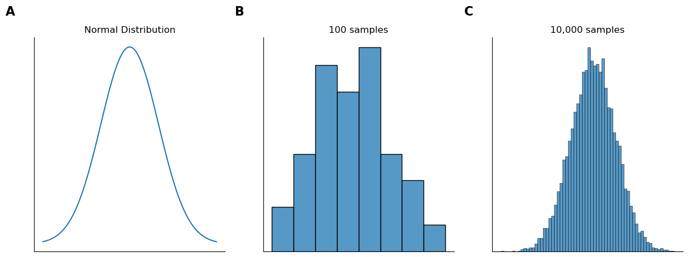
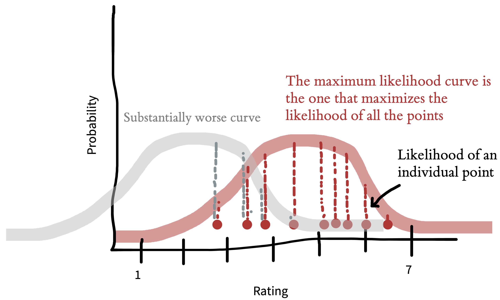
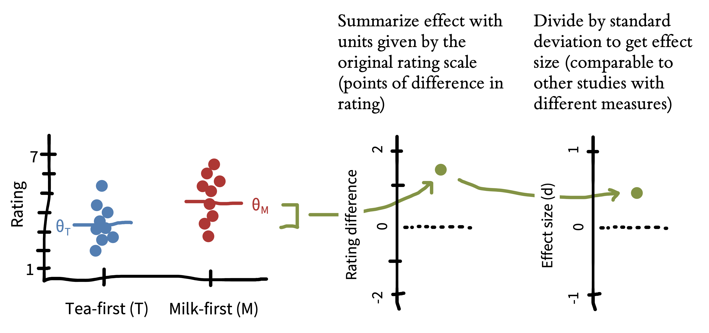
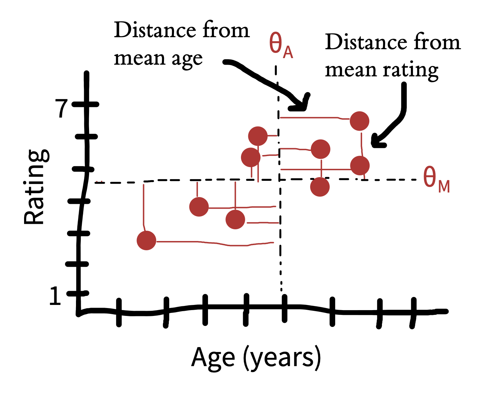

# Estimation

## Key concepts

- Population
- Sample
- Parameters
- Estimation
- Effect size

## Population

{style="max-width:90%"}

[The population as a probability distribution]{.caption}

[@navarroLearningStatisticsPython2021]

## Distribution Parameters

:::: {.columns}
::: {.column width="35%"}
- Mean
- Standard deviation
:::
::: {.column width="65%"}
```{=html}
<iframe src="params_demo.html" style="width:100%; height:440px; border:1px solid var(--ctp-surface2); border-radius:10px; background:white;"></iframe>
```
:::
::::

## Estimating the Population Parameters

:::: {.columns}
::: {.column width="50%"}
- We don't usually know the true population parameters
- We have to estimate them based on sampling
:::
::: {.column width="50%"}
```{=html}
<iframe src="sample_demo.html" style="width:100%; height:470px; border:1px solid var(--ctp-surface2); border-radius:10px; background:white;"></iframe>
```
:::
::::

## The law of large numbers

```{=html}
<iframe src="lln_demo.html" style="width:100%; height:560px; border:1px solid var(--ctp-surface2); border-radius:10px; background:white;"></iframe>
```

## The law of large numbers

<span class="math-html"><i>N</i> → ∞ &nbsp;&nbsp;⇒&nbsp;&nbsp; <span class="xbar">X</span> → <i>μ</i></span>

The more data we have, the closer our parameter estimates get to the true population parameters

## Estimating the population mean

|Symbol      |What it's called                |Do we know what it is?             |
|:-----------|:-------------------------------|:----------------------------------|
|<span class="xbar">X</span>   |Sample mean                     |Yes - Calculated from the raw data |
|$\mu$       |True population mean            |Almost never known for sure        |
|$\hat{\mu}$ |Estimate of the population mean |Yes - Identical to the sample mean |

> A sample statistic is a description of your data, whereas the estimate is a guess about the population.

## Estimating the population standard deviation

:::: {.columns}
::: {.column width="40%"}
```{=html}
<math display="block"><mrow><mi>s</mi><mo>=</mo><msqrt><mfrac><mrow><mo>∑</mo><msup><mrow><mo>(</mo><mi>X</mi><mo>−</mo><mover><mi>X</mi><mo accent="true">‾</mo></mover><mo>)</mo></mrow><mn>2</mn></msup></mrow><mrow mathcolor="#CD5909"><mi>N</mi></mrow></mfrac></msqrt></mrow></math>
```

```{=html}
<math display="block"><mrow><mover><mi>σ</mi><mo>^</mo></mover><mo>=</mo><msqrt><mfrac><mrow><mo>∑</mo><msup><mrow><mo>(</mo><mi>X</mi><mo>−</mo><mover><mi>X</mi><mo accent="true">‾</mo></mover><mo>)</mo></mrow><mn>2</mn></msup></mrow><mrow mathcolor="#4C827B"><mi>N</mi><mo>−</mo><mn>1</mn></mrow></mfrac></msqrt></mrow></math>
```

[Bessel's correction]{.caption}
:::
::: {.column width="60%"}
```{=html}
<iframe src="bessel_demo.html" style="width:100%; height:470px; border:1px solid var(--ctp-surface2); border-radius:10px; background:white;"></iframe>
```
:::
::::

## Estimating the population standard deviation

|Symbol           |What it's called                              |Do we know what it is?                                   |
|:----------------|:---------------------------------------------|:--------------------------------------------------------|
|$s$              |Sample standard deviation                     |Yes - calculated from the raw data                       |
|$\sigma$         |Population standard deviation                 |Almost never known for sure                              |
|$\hat{\sigma}$   |Estimate of the population standard deviation |Yes - but not the same as the sample standard deviation  |
|$s^2$            |Sample variance                               |Yes - calculated from the raw data                       |
|$\sigma^2$       |Population variance                           |Almost never known for sure                              |
|$\hat{\sigma}^2$ |Estimate of the population variance           |Yes - but not the same as the sample variance            |

## Maximum Likelihood Estimation



[Assuming a distribution, find the parameters that best fit the data]{.caption}

[@petrovicsExperimentologyOpenScience2025]

## Maximum Likelihood Estimation

```{=html}
<iframe src="mle_demo.html" style="width:100%; height:560px; border:1px solid var(--ctp-surface2); border-radius:10px; background:white;"></iframe>
```

## Other Distributions

```{=html}
<iframe src="dist_demo.html" style="width:100%; height:560px; border:1px solid var(--ctp-surface2); border-radius:10px; background:white;"></iframe>
```

# Effect size

## What is an effect?

:::: {.columns}
::: {.column width="40%"}
How big is the effect of the independent variable on the dependent variable?

(NOT the same thing as statistical significance!)
:::
::: {.column width="60%"}
```{=html}
<iframe src="effect_demo.html" style="width:100%; height:470px; border:1px solid var(--ctp-surface2); border-radius:10px; background:white;"></iframe>
```
:::
::::

## Effect Size: Cohen's d

:::: {.columns}
::: {.column width="45%"}
$$\hat{d} = \frac{\hat{\theta}_M - \hat{\theta}_T}{\hat{\sigma}_{\text{pooled}}} = \frac{4.5 - 3.5}{1.25} = 0.80$$
:::
::: {.column width="55%"}
{style="max-width:100%"}
:::
::::

[Measured in standard deviation units]{.caption}

[@petrovicsExperimentologyOpenScience2025]

## Effect Size: Cohen's d

```{=html}
<iframe src="cohens_d_demo.html" style="width:100%; height:560px; border:1px solid var(--ctp-surface2); border-radius:10px; background:white;"></iframe>
```

## Pearson's r

:::: {.columns}
::: {.column width="50%"}
Covariance

$$\text{cov}(M, A) = E[(M - \theta_M)(A - \theta_A)]$$

Correlation coefficient

$$r_{M,A} = \frac{\text{cov}(M, A)}{\sigma_M \sigma_A}$$
:::
::: {.column width="50%"}
{style="max-width:100%"}
:::
::::

[@petrovicsExperimentologyOpenScience2025]

## Pearson's r

```{=html}
<iframe src="corr_demo.html" style="width:100%; height:560px; border:1px solid var(--ctp-surface2); border-radius:10px; background:white;"></iframe>
```

## Key concepts

- Population
- Sample
- Parameters
- Estimation
- Effect size

# References

## References {.scrollable}

::: {#refs}
:::
