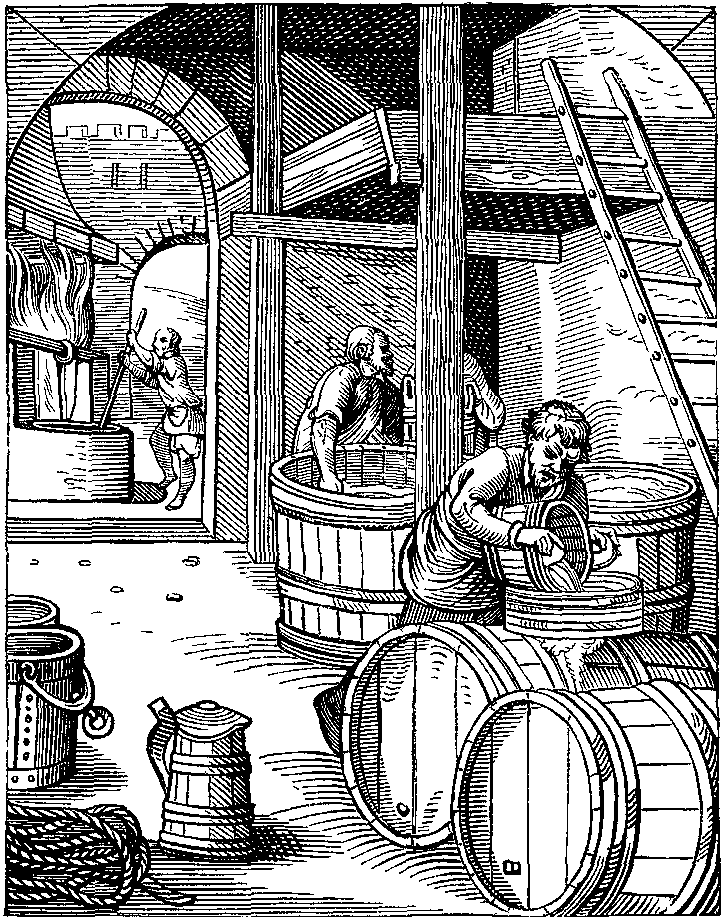
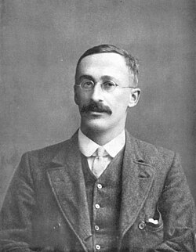
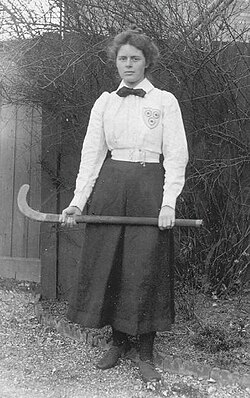
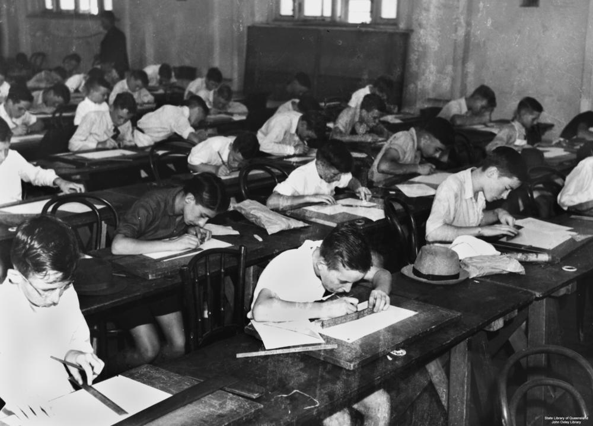
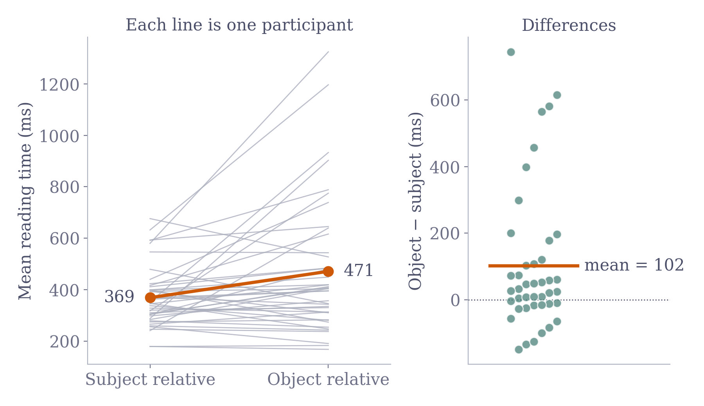

# T-tests

## Sampling

```{=html}
<iframe src="sampling_pile_demo.html" style="width:100%; height:560px; border:1px solid var(--ctp-surface2); border-radius:10px; background:white;"></iframe>
```

## Beer

{style="max-height:560px"}

## A. Student

:::: {.columns}
::: {.column width="50%"}
{style="max-height:480px"}

[William Sealy Gosset (1876 – 1937)]{.caption}
:::
::: {.column width="50%"}
{style="max-height:480px"}

[Marjory Surtees Gosset (1879 – 1965)]{.caption}
:::
::::

## Small samples

```{=html}
<iframe src="small_samples_demo.html" style="width:100%; height:520px; border:1px solid var(--ctp-surface2); border-radius:10px; background:white;"></iframe>
```

## Normal vs. t

```{=html}
<iframe src="normal_t_demo.html" style="width:100%; height:560px; border:1px solid var(--ctp-surface2); border-radius:10px; background:white;"></iframe>
```

## One-sample t-test

```{=html}
<iframe src="one_sample_t_demo.html" style="width:100%; height:600px; border:1px solid var(--ctp-surface2); border-radius:10px; background:white;"></iframe>
```

## Independent t-test

```{=html}
<iframe src="independent_t_demo.html" style="width:100%; height:580px; border:1px solid var(--ctp-surface2); border-radius:10px; background:white;"></iframe>
```

## Paired t-test

```{=html}
<div style="display:flex; align-items:center; gap:8px; width:calc(100% + 120px); margin-left:-60px;">

<iframe src="paired_t_demo.html" style="flex:1; min-width:0; height:560px; border:1px solid var(--ctp-surface2); border-radius:10px; background:white;"></iframe>

</div>
```

# Example

## Relative clauses

- Subject relative: The reporter who **sent** the photographer ...
- Object relative: The reporter who the photographer **sent** ...

[42 participants, 16 items; reading time at the relative clause verb [@grodner2005]; data from the lingpsych R package [@lingpsych]]{.caption}

## Paired t-test result

:::: {.columns}
::: {.column width="68%"}
{style="max-width:100%; max-height:none; width:100%"}
:::
::: {.column width="32%"}
::: {.formula style="font-size:0.6em"}
$$t = \frac{102.3}{213.2 / \sqrt{42}} = 3.11$$
:::

t(41) = 3.11, p = .003

d~z~ = 0.48

[95% CI of the difference: 36 to 169 ms]{.caption}
:::
::::

## Live coding

```{=html}
<iframe src="pycode_demo.html" style="width:100%; height:560px; border:1px solid var(--ctp-surface2); border-radius:10px; background:white;"></iframe>
```

# References

## References {.scrollable}

::: {#refs}
:::

## Images {.scrollable}

::: {#imagecredits}

- **The Brewer** — Designed and engraved in the sixteenth century by J. Amman. [Wikipedia](https://en.wikipedia.org/wiki/Brewing#/media/File:The_Brewer_designed_and_engraved_in_the_Sixteenth._Century_by_J_Amman.png)
- **William Sealy Gosset** — [Wikipedia](https://en.wikipedia.org/wiki/William_Sealy_Gosset)
- **Marjory Surtees Gosset** — [Wikipedia](https://en.wikipedia.org/wiki/Marjory_Gosset)
- **Beer acidity chart** — [Oculyze](https://www.oculyze.net/the-beer-acidity-chart/)
- **Coffee cup** — [Pngtree](https://pngtree.com/freepng/a-small-cup-of-delicious-black-coffee_5990169.html)
- **Students at their desks** — Item is held by John Oxley Library, State Library of Queensland. Public domain. [Wikimedia Commons](https://commons.wikimedia.org/w/index.php?curid=12344846)
- **Beer keg** — Clip art from [beer object set](https://img.magnific.com/free-vector/beer-object-set_225004-1141.jpg)

:::
