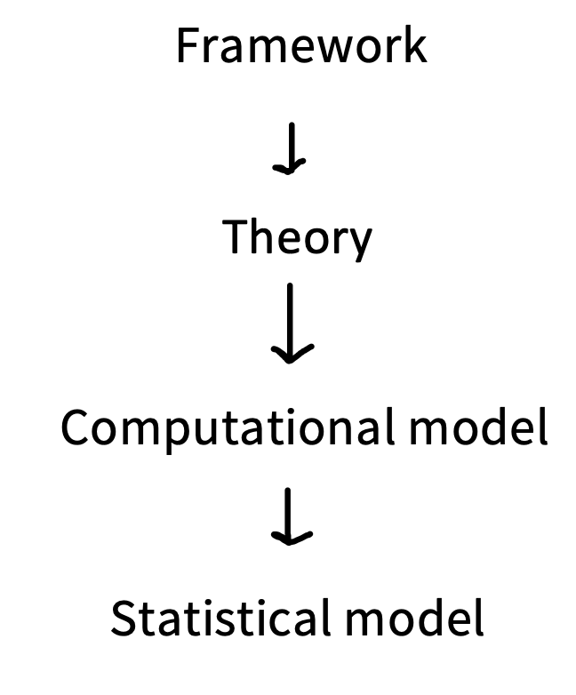
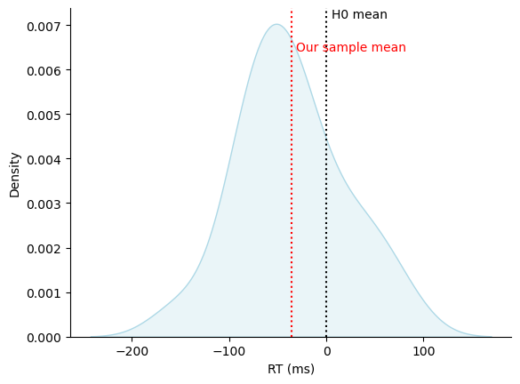
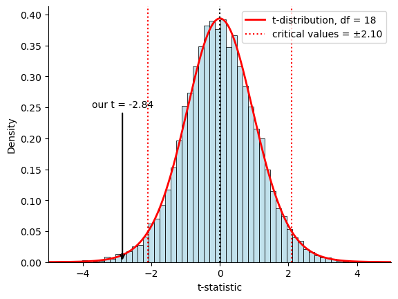

# Inference

## Inference in general

:::: {.columns}
::: {.column width="60%"}
> I never saw a wreck and have never been wrecked, nor was I ever in any predicament that threatened to end in disaster of any sort.
>
> — Captain E. J. Smith
:::
::: {.column width="40%"}
{width=80%}
:::
::::


## NHST

:::: {.columns}
::: {.column width="60%"}
- null hypothesis significance testing
- is it all Popper's fault?
:::
::: {.column width="40%"}
{width=80%}

[Karl Popper (1902-1994)]{.caption}
:::
::::

## The Null Hypothesis (H~0~)

- The experimental manipulation has no effect
- The independent and dependent variables are causally unrelated


## The Null Hypothesis (H~0~)

Usually...

- the null hypothesis is the hypothesis that I hope isn't true
- the alternative hypothesis is the hypothesis that I hope is true

::: fragment
This is statistics. Abandon all hope.
:::

## Type I and II Errors

:::: {.columns .errtable}
::: {.column .fragment width="50%"}
|  | retain H~0~ | reject H~0~ |
|---|---|---|
| **H~0~ is true** | correct decision | error (type I)<br>[false positive]{style="color:#d20f39"} |
| **H~0~ is false** | error (type II)<br>[false negative]{style="color:#d20f39"} | correct decision |
:::
::: {.column .fragment width="50%"}
|  | retain H~0~ | reject H~0~ |
|---|---|---|
| **H~0~ is true** | 1 − α (probability of correct retention) | α (type I error rate) |
| **H~0~ is false** | β (type II error rate) | 1 − β (power of the test) |
:::
::::

## Statistical significance

:::: {.columns}
::: {.column width="60%"}
- null hypothesis significance testing
- definitely Fisher's fault
- a statement about the likelihood of the observing data as or more extreme as the observed results under the null hypothesis
:::
::: {.column width="40%"}
{width=80%}

[Ronald Fisher (1890-1962)]{.caption}
:::
::::


## Statistical significance

Is not the same as...  

- Theoretical significance
- Clinical significance
- Importance of any kind


## NHST (again)

In the NHST framework...

- we can never "prove" anything to be true
- the best we can hope for is to repeatedly fail to find support for the null hypothesis
- “whenever we propose a solution to a problem, we ought to try as hard as we can to overthrow our solution, rather than defend it.” [@popper2005, p. xix]


# Example: Priming in Lexical Access

jupyter notebook is [here](https://github.com/ethanweed/ExPsyLing/blob/master/slides/10/masked-priming-example.ipynb)

## Levels of theoretical tools

:::: {.columns}
::: {.column width="50%"}
{width=80%}
:::
::: {.column width="50%"}
```{=html}
<div class="modellabel">theory (causal model)</div>
<svg viewBox="0 0 620 150" style="width:100%; display:block; margin:0 auto;" font-family="'Source Serif 4', Georgia, serif">
  <defs>
    <marker id="dagarrow" viewBox="0 0 10 10" refX="9" refY="5" markerWidth="8" markerHeight="8" orient="auto">
      <path d="M0,0 L10,5 L0,10 z" fill="#4C827B"/>
    </marker>
  </defs>
  <rect x="5" y="20" width="230" height="110" rx="55" fill="#4C827B" fill-opacity="0.15" stroke="#4C827B" stroke-width="3"/>
  <text x="120" y="70" text-anchor="middle" font-size="26" fill="#05253A">subliminal</text>
  <text x="120" y="100" text-anchor="middle" font-size="26" fill="#05253A">priming</text>
  <line x1="238" y1="75" x2="372" y2="75" stroke="#4C827B" stroke-width="4" marker-end="url(#dagarrow)"/>
  <rect x="380" y="20" width="235" height="110" rx="55" fill="#4C827B" fill-opacity="0.15" stroke="#4C827B" stroke-width="3"/>
  <text x="497" y="70" text-anchor="middle" font-size="26" fill="#05253A">change in lexical</text>
  <text x="497" y="100" text-anchor="middle" font-size="26" fill="#05253A">access RT</text>
</svg>
<hr class="modelsep">
<div class="modellabel">statistical model (paired t-test)</div>
<div class="formula" style="font-size:1.2em; text-align:center;">H<sub>0</sub>: <span class="xbar">D</span> = 0</div>
<div class="formula" style="font-size:1.2em; text-align:center;">H<sub>1</sub>: <span class="xbar">D</span> ≠ 0</div>
```
:::
::::


## 

:::: {.columns}
::: {.column width="35%"}
<details open class="codebox"><summary>code</summary>

```python
# A bunch of code to clean up the raw data and fix the mislabeld items.

#Install and import libraries

# Install packages if you need them
#%pip install pandas
#%pip install seaborn
#%pip install scipy

# Import packages
import pandas as pd
import seaborn as sns
import pingouin as pg
import numpy as np

# Read in the data from the url
url = 'https://raw.githubusercontent.com/ethanweed/ExPsyLing/refs/heads/master/experiments/masked_prime/data/combined_data.csv'
raw = pd.read_csv(url)                                                      # read in the data from the url

# Make a list of all the columns we want to keep
cols = ['participant_id', 'sender', 'duration', 'prime', 'target', 'condition', 'soa_condition', 'congruence', 'response', 'correct_response']

# Filter the data to keep only the columns we want, and only the rows we want
df = raw[cols]                                                             # make a new dataframe with only the columns in cols
df = df[df['sender'] == 'target']                                          # only keep the "target" rows
df = df[df['condition'] != 'practice']                                     # throw away the practice trials

# Some of the target words were labeled incorrectly in the original data, so we need to fix those.
incorrect_labels = ['LAND', 'TREE', 'BEAR', 'ROSE', 'HILL', 'DIRT', 'BULL', 'DUCK']
for word in incorrect_labels:
    df.loc[df['target'] == word, 'correct_response'] = 'n'                 # fix items with incorrect answer lables

df['correct'] = (df['response'] == df['correct_response']).astype(int)     # make a new column with 0 or 1 for incorrect / correct
df = df[df['correct'] == 1]                                                # keep only the correct responses   
df = df.rename(columns={'soa_condition': 'soa', 'duration': 'rt'})         # rename the soa and duration columns, just to look nicer
```

</details>
:::
::: {.column width="65%"}

:::
::::

## 

:::: {.columns}
::: {.column width="35%"}
<details open class="codebox"><summary>code</summary>

```python
# Inspect the data
df.head()
```

</details>
:::
::: {.column width="65%"}
```{=html}
<div class="nbout"><div>

<table border="1" class="dataframe">
  <thead>
    <tr style="text-align: right;">
      <th></th>
      <th>participant_id</th>
      <th>sender</th>
      <th>rt</th>
      <th>prime</th>
      <th>target</th>
      <th>condition</th>
      <th>soa</th>
      <th>congruence</th>
      <th>response</th>
      <th>correct_response</th>
      <th>correct</th>
    </tr>
  </thead>
  <tbody>
    <tr>
      <th>40</th>
      <td>51</td>
      <td>target</td>
      <td>520.14</td>
      <td>roof</td>
      <td>PIANO</td>
      <td>Inc_Synth_Synth</td>
      <td>long</td>
      <td>incongruent</td>
      <td>m</td>
      <td>m</td>
      <td>1</td>
    </tr>
    <tr>
      <th>47</th>
      <td>51</td>
      <td>target</td>
      <td>640.66</td>
      <td>sheep</td>
      <td>BULL</td>
      <td>Inc_Nat_Nat</td>
      <td>long</td>
      <td>incongruent</td>
      <td>n</td>
      <td>n</td>
      <td>1</td>
    </tr>
    <tr>
      <th>54</th>
      <td>51</td>
      <td>target</td>
      <td>597.74</td>
      <td>fort</td>
      <td>GOAT</td>
      <td>Inc_Synth_Nat</td>
      <td>long</td>
      <td>incongruent</td>
      <td>n</td>
      <td>n</td>
      <td>1</td>
    </tr>
    <tr>
      <th>61</th>
      <td>51</td>
      <td>target</td>
      <td>495.68</td>
      <td>pear</td>
      <td>PEAR</td>
      <td>Con_Nat</td>
      <td>long</td>
      <td>congruent</td>
      <td>n</td>
      <td>n</td>
      <td>1</td>
    </tr>
    <tr>
      <th>68</th>
      <td>51</td>
      <td>target</td>
      <td>556.86</td>
      <td>olive</td>
      <td>MOTOR</td>
      <td>Inc_Nat_Synth</td>
      <td>long</td>
      <td>incongruent</td>
      <td>m</td>
      <td>m</td>
      <td>1</td>
    </tr>
  </tbody>
</table>
</div></div>
```
:::
::::

## 

:::: {.columns}
::: {.column width="35%"}
<details open class="codebox"><summary>code</summary>

```python
# Calculate the mean RT for each participant in each congruence condition
data = df.groupby(['participant_id', 'congruence']).agg({'rt': 'mean'}).reset_index()

# Pivot the data to make it wide format, with one row per participant and one column per congruence condition
data_wide = data.pivot(index='participant_id', columns='congruence', values='rt').reset_index()
data_wide.head()
```

</details>
:::
::: {.column width="65%"}
```{=html}
<div class="nbout"><div>

<table border="1" class="dataframe">
  <thead>
    <tr style="text-align: right;">
      <th>congruence</th>
      <th>participant_id</th>
      <th>congruent</th>
      <th>incongruent</th>
    </tr>
  </thead>
  <tbody>
    <tr>
      <th>0</th>
      <td>51</td>
      <td>583.810000</td>
      <td>615.085714</td>
    </tr>
    <tr>
      <th>1</th>
      <td>52</td>
      <td>720.660000</td>
      <td>770.758929</td>
    </tr>
    <tr>
      <th>2</th>
      <td>53</td>
      <td>687.794545</td>
      <td>715.216981</td>
    </tr>
    <tr>
      <th>3</th>
      <td>54</td>
      <td>656.438182</td>
      <td>745.021569</td>
    </tr>
    <tr>
      <th>4</th>
      <td>55</td>
      <td>835.101852</td>
      <td>757.564286</td>
    </tr>
  </tbody>
</table>
</div></div>
```
:::
::::

## 

:::: {.columns}
::: {.column width="35%"}
<details open class="codebox"><summary>code</summary>

```python
# Calculate the difference score for each participant (congruent - incongruent)
data_wide['D'] = data_wide['congruent'] - data_wide['incongruent']
data_wide.head(20)
```

</details>
:::
::: {.column width="65%"}
```{=html}
<div class="nbout"><div>

<table border="1" class="dataframe">
  <thead>
    <tr style="text-align: right;">
      <th>congruence</th>
      <th>participant_id</th>
      <th>congruent</th>
      <th>incongruent</th>
      <th>D</th>
    </tr>
  </thead>
  <tbody>
    <tr>
      <th>0</th>
      <td>51</td>
      <td>583.810000</td>
      <td>615.085714</td>
      <td>-31.275714</td>
    </tr>
    <tr>
      <th>1</th>
      <td>52</td>
      <td>720.660000</td>
      <td>770.758929</td>
      <td>-50.098929</td>
    </tr>
    <tr>
      <th>2</th>
      <td>53</td>
      <td>687.794545</td>
      <td>715.216981</td>
      <td>-27.422436</td>
    </tr>
    <tr>
      <th>3</th>
      <td>54</td>
      <td>656.438182</td>
      <td>745.021569</td>
      <td>-88.583387</td>
    </tr>
    <tr>
      <th>4</th>
      <td>55</td>
      <td>835.101852</td>
      <td>757.564286</td>
      <td>77.537566</td>
    </tr>
    <tr>
      <th>5</th>
      <td>56</td>
      <td>555.301852</td>
      <td>602.697826</td>
      <td>-47.395974</td>
    </tr>
    <tr>
      <th>6</th>
      <td>57</td>
      <td>670.320000</td>
      <td>753.068519</td>
      <td>-82.748518</td>
    </tr>
    <tr>
      <th>7</th>
      <td>58</td>
      <td>751.071429</td>
      <td>836.826923</td>
      <td>-85.755495</td>
    </tr>
    <tr>
      <th>8</th>
      <td>59</td>
      <td>749.790909</td>
      <td>703.354386</td>
      <td>46.436523</td>
    </tr>
    <tr>
      <th>9</th>
      <td>60</td>
      <td>577.580702</td>
      <td>608.235088</td>
      <td>-30.654386</td>
    </tr>
    <tr>
      <th>10</th>
      <td>61</td>
      <td>891.547170</td>
      <td>1042.188679</td>
      <td>-150.641509</td>
    </tr>
    <tr>
      <th>11</th>
      <td>62</td>
      <td>614.017241</td>
      <td>669.941509</td>
      <td>-55.924268</td>
    </tr>
    <tr>
      <th>12</th>
      <td>63</td>
      <td>774.641509</td>
      <td>732.348148</td>
      <td>42.293361</td>
    </tr>
    <tr>
      <th>13</th>
      <td>64</td>
      <td>728.454545</td>
      <td>799.796296</td>
      <td>-71.341751</td>
    </tr>
    <tr>
      <th>14</th>
      <td>65</td>
      <td>833.092000</td>
      <td>825.914583</td>
      <td>7.177417</td>
    </tr>
    <tr>
      <th>15</th>
      <td>66</td>
      <td>862.478000</td>
      <td>883.217647</td>
      <td>-20.739647</td>
    </tr>
    <tr>
      <th>16</th>
      <td>67</td>
      <td>794.364912</td>
      <td>781.400000</td>
      <td>12.964912</td>
    </tr>
    <tr>
      <th>17</th>
      <td>68</td>
      <td>793.224138</td>
      <td>843.000000</td>
      <td>-49.775862</td>
    </tr>
    <tr>
      <th>18</th>
      <td>69</td>
      <td>713.901724</td>
      <td>794.232727</td>
      <td>-80.331003</td>
    </tr>
  </tbody>
</table>
</div></div>
```
:::
::::

## 

:::: {.columns}
::: {.column width="35%"}
<details open class="codebox"><summary>code</summary>

```python
## Plot the distribution of difference scores
ax = sns.kdeplot(data_wide['D'], fill=True, color='lightblue')                              # plot the distribution of difference scores
sns.despine()                                                                               # I was trained to prefer this 30 years ago. Can't help it.
ax.axvline(0, color='black', linestyle=':', linewidth=1.5)                                  # Draw a dotted line at 0 (the null hypothesis)
ax.axvline(data_wide['D'].mean(), color='red', linestyle=':', linewidth=1.5)                # Draw a dotted line at the mean of the difference scores
ax.text(0+5, 1, "H0 mean", transform=ax.get_xaxis_transform(),      
    color="black", ha="left", va="top")                                                     # Draw a label for the null hypothesis mean
ax.text(data_wide['D'].mean()+5, .9, "Our sample mean", transform=ax.get_xaxis_transform(),
    color="red", ha="left", va="top")                                                       # Draw a label for the sample mean
ax.set_xlabel('RT (ms)')                                                                    # Make a more sensible x-axis label
```

</details>
:::
::: {.column width="65%"}
{width=100%}
:::
::::

## 

:::: {.columns}
::: {.column width="35%"}
<details open class="codebox"><summary>code</summary>

```python
pg.ttest(data_wide['congruent'], data_wide['incongruent'], paired=True)
```

</details>
:::
::: {.column width="65%"}
```{=html}
<div class="nbout"><div>

<table border="1" class="dataframe">
  <thead>
    <tr style="text-align: right;">
      <th></th>
      <th>T</th>
      <th>dof</th>
      <th>alternative</th>
      <th>p-val</th>
      <th>CI95%</th>
      <th>cohen-d</th>
      <th>BF10</th>
      <th>power</th>
    </tr>
  </thead>
  <tbody>
    <tr>
      <th>T-test</th>
      <td>-2.844799</td>
      <td>18</td>
      <td>two-sided</td>
      <td>0.010751</td>
      <td>[-62.8, -9.44]</td>
      <td>0.354374</td>
      <td>4.898</td>
      <td>0.309804</td>
    </tr>
  </tbody>
</table>
</div></div>
```
:::
::::

## 

:::: {.columns}
::: {.column width="35%"}
<details open class="codebox"><summary>code</summary>

```python
# SIMULATION: What do t-statistics look like when the null hypothesis (H0) is true?
#
# The idea: imagine a world where masked priming has NO effect, so the true mean
# difference between congruent and incongruent RTs is exactly 0.
# In that world, we "run our experiment" thousands of times, and each time we
# compute a t-statistic. Then we look at the distribution of all those t-values.

from scipy import stats   # we only need scipy for the theoretical t-distribution

# Settings for the simulation
# We copy the sample size and spread from our real data, so the simulated experiments
# look like ours in every way, except that the true effect is 0.
N = len(data_wide['D'])        # number of participants in our experiment
sd = data_wide['D'].std()      # standard deviation of our difference scores
n_experiments = 10000          # how many times we "repeat" the experiment

# A random number generator. We set a "seed" so that the results are reproducible.
# We choose 42 for the seed, because we are dorks.
rng = np.random.default_rng(42)

# Run the simulated experiments, and calculate a t-value for each one. Store the t-values in a list.
t_values = []                  # an empty list to collect one t-value per experiment
for i in range(n_experiments):
    # Draw N fake difference scores from a normal distribution centered on 0 (we are assuming H0 is true)
    sim_D = rng.normal(loc=0, scale=sd, size=N)

    # Compute the one-sample t-statistic by hand: t = mean / standard error.
    # (pg.ttest(sim_D, 0) would give the same answer, but it is much slower
    #  when we call it 10,000 times, so we do the arithmetic ourselves.)
    t = sim_D.mean() / (sim_D.std(ddof=1) / np.sqrt(N)) # (ddof=1 gives the sample standard deviation, not the population standard deviation)

    t_values.append(t)         # store this experiment's t-value

# Get our actual t-statistic from the real data, using the same paired t-test we ran above.
t_obs = pg.ttest(data_wide['congruent'], data_wide['incongruent'], paired=True)['T'].iloc[0]

# Critical values
# With alpha = 0.05 (two-tailed), 2.5% of the t-distribution lies in each tail.
# stats.t.ppf finds the t-value that has 97.5% of the distribution below it.
t_crit = stats.t.ppf(0.975, df=N-1)

# Plot the simulated t-values, the theoretical t-distribution under H0, the critical values, and our actual t-statistic.
# Histogram of the 10,000 simulated t-values.
# stat='density' scales the bars so they are comparable with the curve below.
ax = sns.histplot(t_values, stat='density', bins=60, color='lightblue')

# The theoretical t-distribution with N - 1 degrees of freedom.
# stats.t.pdf gives the height of the curve at each x-value.
x = np.linspace(-10, 10, 800)
sns.lineplot(x=x, y=stats.t.pdf(x, df=N-1), color='red', linewidth=2,
             label=f't-distribution, df = {N-1}', ax=ax)

# A dotted line at 0, where the t-values should be centered if H0 is true.
ax.axvline(0, color='black', linestyle=':', linewidth=1.5)

# Dotted red lines at the critical values. A t-value outside these lines
# would be "significant" at p < .05.
ax.axvline(-t_crit, color='red', linestyle=':', linewidth=1.5)
ax.axvline(t_crit, color='red', linestyle=':', linewidth=1.5,
           label=f'critical values = ±{t_crit:.2f}')

# Make an arrow pointing at where our actual t-statistic from our data falls.
ax.annotate(f'our t = {t_obs:.2f}',
            xy=(t_obs, 0),          # where the arrow points (on the x-axis)
            xytext=(t_obs, 0.25),   # where the label text sits
            ha='center',
            arrowprops=dict(arrowstyle='->', color='black', linewidth=1.5))

# Make sure the x-axis is wide enough to show our t-value, then tidy up.
ax.set_xlim(min(-5, t_obs - 1), max(5, t_obs + 1))
ax.set_xlabel('t-statistic')
ax.legend()
sns.despine()

# Check the simulation against the theory
# If H0 is true, the t-values should average about 0, and about 5% of them
# should fall beyond the critical values (that is what alpha = 0.05 means!).
print(f"Mean of simulated t-values: {np.mean(t_values):.3f}")
print(f"Proportion with |t| > {t_crit:.2f}: {np.mean(np.abs(t_values) > t_crit):.3f} (should be about 0.05)")
```

</details>
:::
::: {.column width="65%"}
```
Mean of simulated t-values: -0.005
Proportion with |t| > 2.10: 0.051 (should be about 0.05)
```
{width=100%}
:::
::::

## 

## Levels of specificity

{height=520px}

# References

## References {.scrollable}

::: {#refs}
:::
