## Key concepts

- Graphics *reveal* data
- Graphics tell a *story*
- Lie factor
- Data-ink ratio
- Data density
- Revision

# A short history

## John Snow's cholera map

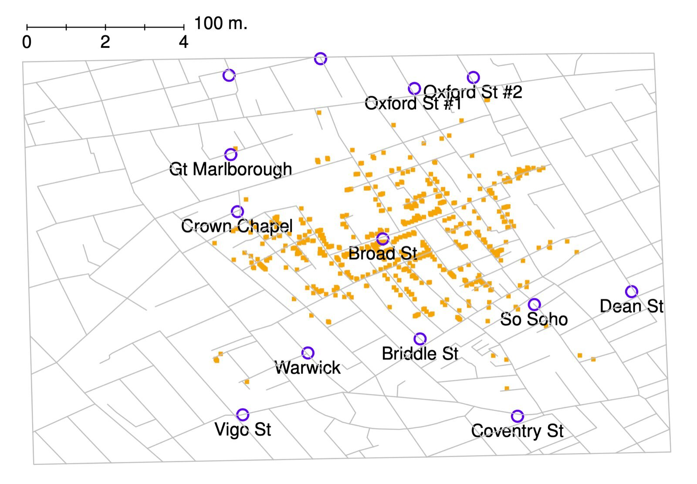{height=520px}

[John Snow's 1854 map of cholera deaths]{.caption}

## Data visualization is a modern invention

:::: {.columns}
::: {.column width="50%"}
**William Playfair** (1759–1823)

- [millwright, engineer, draftsman, accountant, inventor, silversmith, merchant, investment broker, economist, statistician, pamphleteer, translator, publicist, land speculator, banker, ardent royalist, de facto intelligence officer, convict, editor, blackmailer and journalist (Wikipedia)]{.tiny}
- Founder of statistical graphics
- inventor of the bar graph, the pie chart, and the line chart
:::
::: {.column width="50%"}
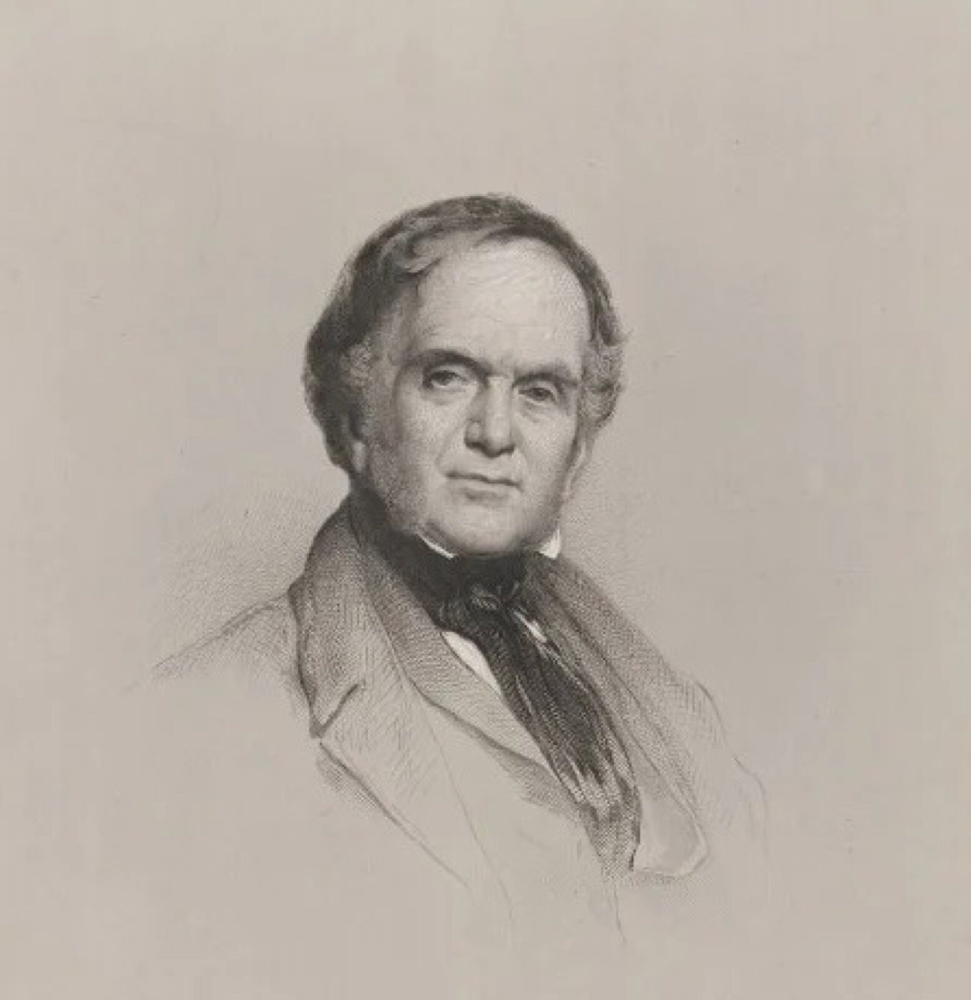{width=80%}
:::
::::

## Edward Tufte

:::: {.columns .vcenter}
::: {.column width="50%"}
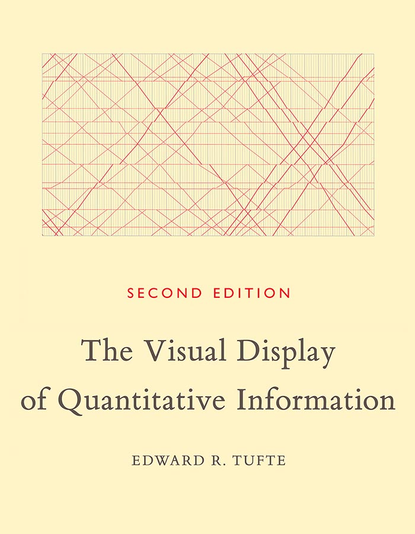{style="height:440px; width:auto; max-height:none;"}
:::
::: {.column width="50%"}
{style="height:400px; width:auto; max-height:none;"}

[Photo: Keegan Peterzell, CC BY-SA 4.0, via Wikimedia Commons]{.tiny}
:::
::::

[@tufte2001]{.caption}

# What graphics do

## Graphics *reveal* data

:::: {.columns}
::: {.column width="40%"}
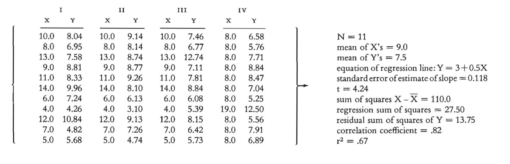
:::
::: {.column width="60%"}
```{=html}
<iframe src="anscombe_demo.html" style="width:100%; height:440px; border:1px solid var(--ctp-surface2); border-radius:10px; background:white;"></iframe>
```
:::
::::

[Anscombe's quartet [@anscombe1973]]{.caption}

## The Datasaurus Dozen

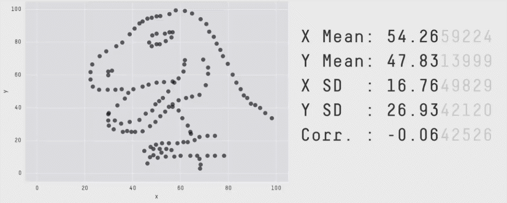{width=100%}

[Same summary statistics, very different data [@datasaurus2026]]{.caption}

## Datawug

```{=html}
<div class="fixy wugfit">
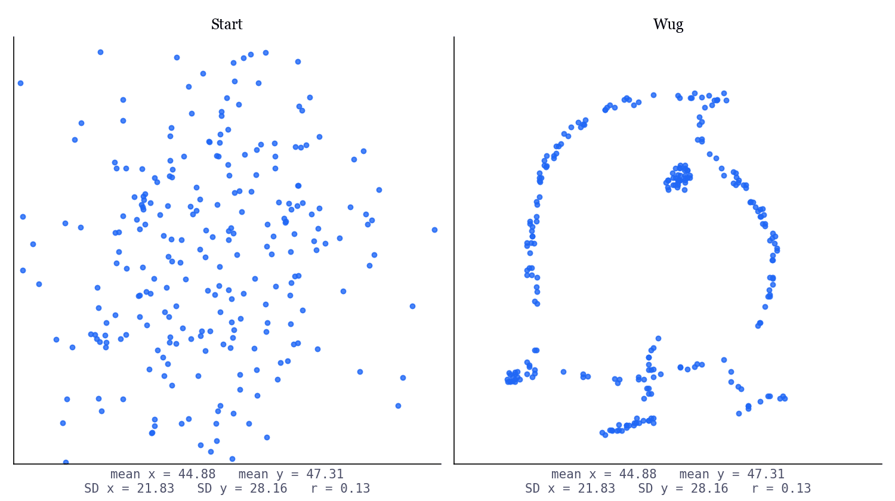
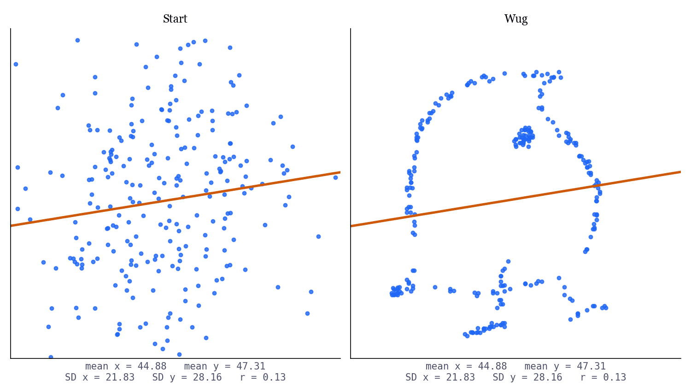
<button onclick="const d=this.parentNode, o=d.querySelector('.orig'), f=d.querySelector('.fixed'), show=f.style.display==='none'; f.style.display=show?'block':'none'; o.style.display=show?'none':'block'; this.textContent=show?'Hide regression line':'Add regression line';">Add regression line</button>
</div>
```

## Garbage in, garbage out

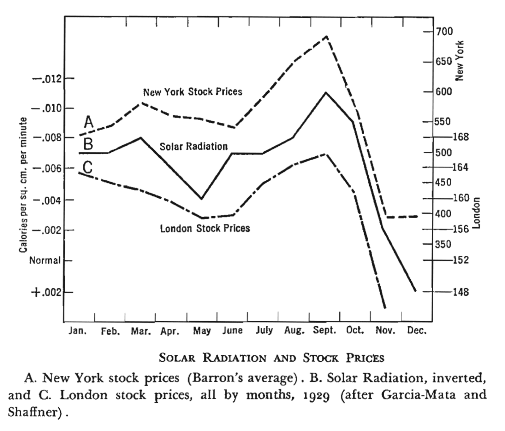{height=520px}

[@tufte2001]{.caption}

## Garbage in, garbage out

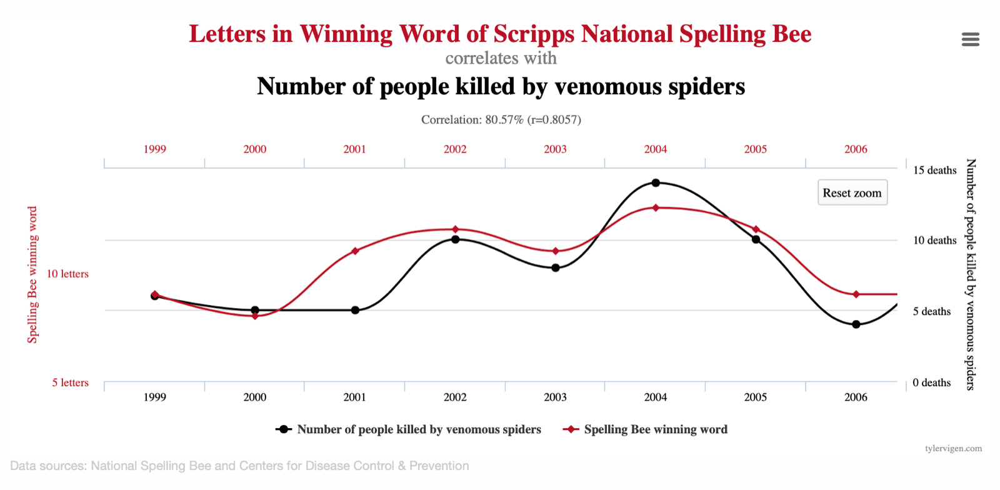{width=80%}

[r = 0.80 ("strong") [@vigen2015]]{.caption}

## Graphics tell a *story*

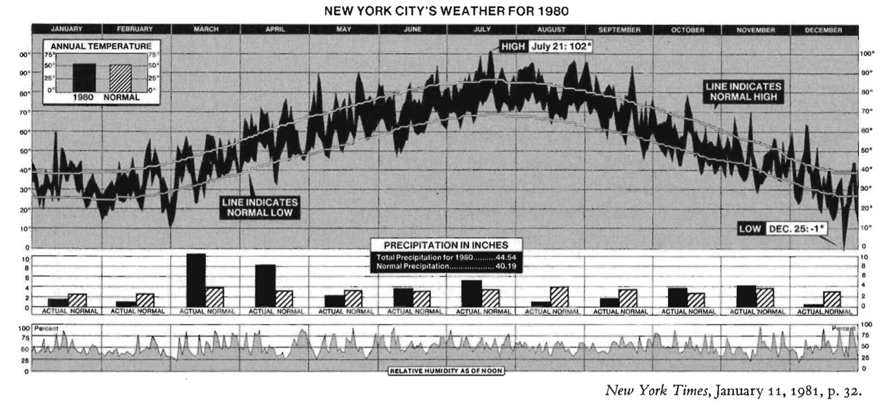{width=100%}

[A picture speaks 1888 numbers [@tufte2001]]{.caption}

## Graphics tell a *story*

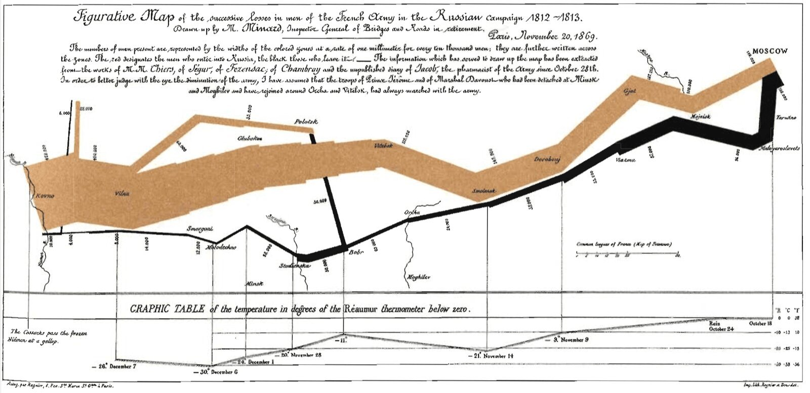{width=100%}

[Charles Joseph Minard (1869). Translation by Dawn Finley, redrawing by Elaine Morse]{.caption}

## Four variables, one picture

:::: {.columns}
::: {.column width="60%"}

:::
::: {.column width="40%"}
- Size of the army
- Location
- Direction of movement
- Temperature during the retreat
:::
::::

## Best and worst

:::: {.columns}
::: {.column width="50%" .bwquote}


> "It may well be the best statistical graphic ever drawn"
:::
::: {.column width="50%" .fragment .bwquote}
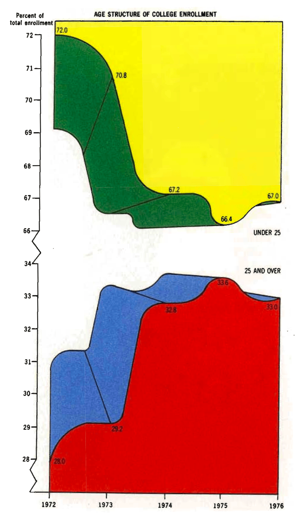{style="height:330px; width:auto;"}

> "It may well be the worst graphic ever to find its way into print"
:::
::::

[@tufte2001]{.caption}

## The worst graphic ever

{height=540px}

# What makes a good graphic?

## Most information, least time

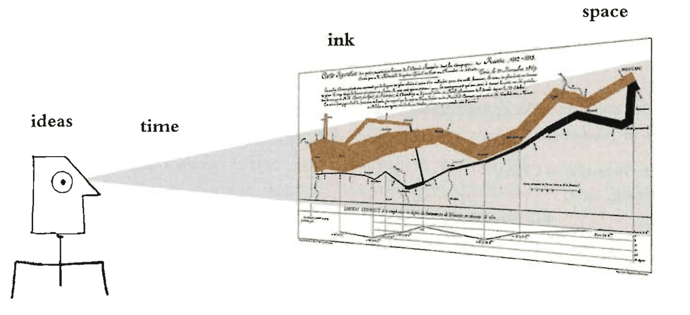{height=520px}

[@tufte2001]{.caption}

## A good graphic is truthful

::: {.formula style="font-size:1.3em"}
$$\text{lie factor} = \frac{\text{size of effect shown in graph}}{\text{size of effect in data}}$$
:::

[@tufte2001]{.caption}


## No y-axis labels

:::: {.columns .vcenter}
::: {.column width="40%"}
::: {.formula style="font-size:0.7em"}
$$\text{lie factor} = \frac{\text{size of effect shown in graph}}{\text{size of effect in data}}$$
:::
:::
::: {.column width="60%"}
```{=html}
<div class="fixy">

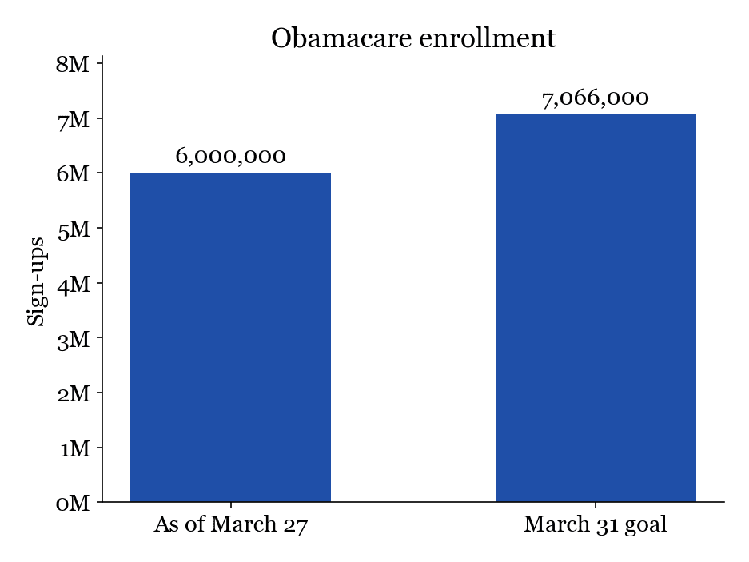
<button onclick="const d=this.parentNode, o=d.querySelector('.orig'), f=d.querySelector('.fixed'), show=f.style.display==='none'; f.style.display=show?'block':'none'; o.style.display=show?'none':'block'; this.textContent=show?'Show original':'Fix y axis';">Fix y axis</button>
</div>
```
:::
::::

[@notopoulos2014]{.caption}

## Very selective y-axis labels

:::: {.columns .vcenter}
::: {.column width="40%"}
::: {.formula style="font-size:0.7em"}
$$\text{lie factor} = \frac{\text{size of effect shown in graph}}{\text{size of effect in data}}$$
:::
:::
::: {.column width="60%"}
```{=html}
<div class="fixy">
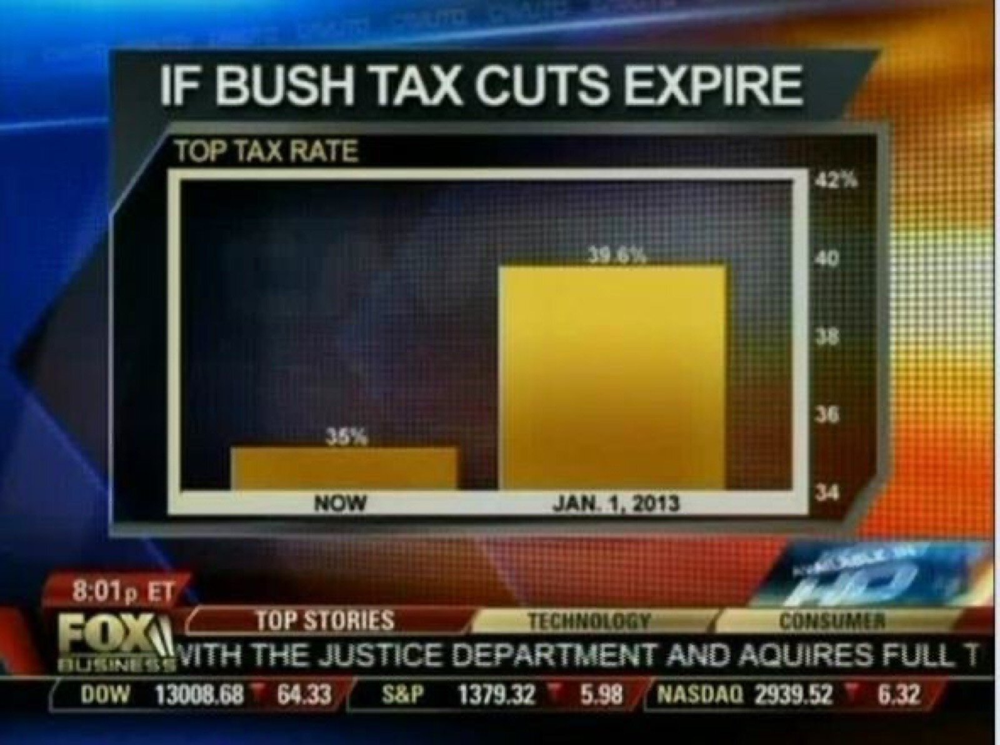
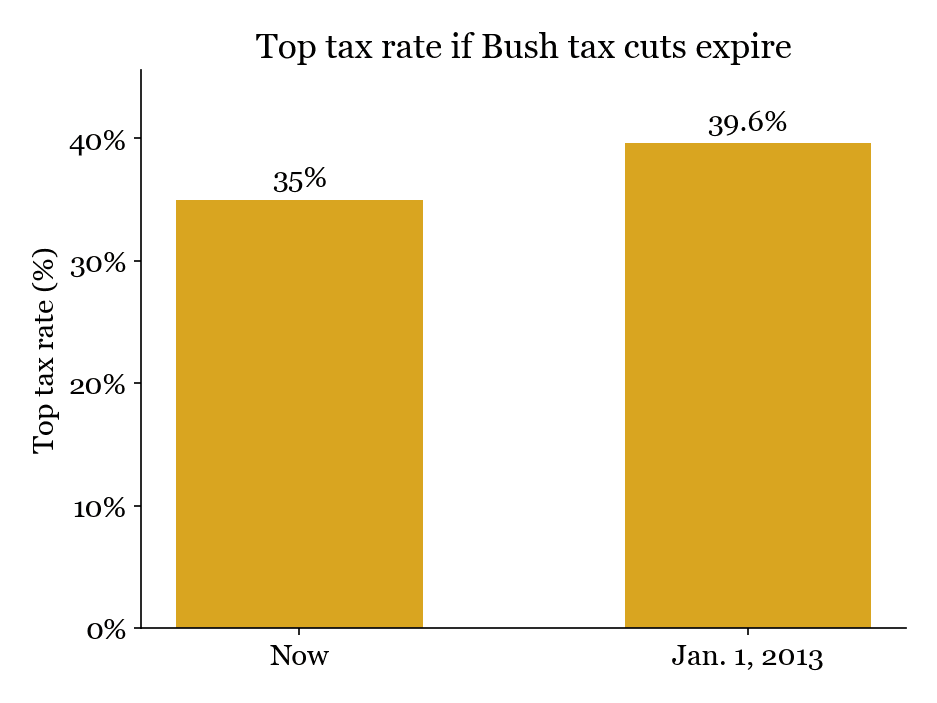
<button onclick="const d=this.parentNode, o=d.querySelector('.orig'), f=d.querySelector('.fixed'), show=f.style.display==='none'; f.style.display=show?'block':'none'; o.style.display=show?'none':'block'; this.textContent=show?'Show original':'Fix y axis';">Fix y axis</button>
</div>
```
:::
::::

[@notopoulos2014]{.caption}

## Again, no y-axis labels

:::: {.columns .vcenter}
::: {.column width="40%"}
::: {.formula style="font-size:0.7em"}
$$\text{lie factor} = \frac{\text{size of effect shown in graph}}{\text{size of effect in data}}$$
:::
:::
::: {.column width="60%"}
```{=html}
<div class="fixy">
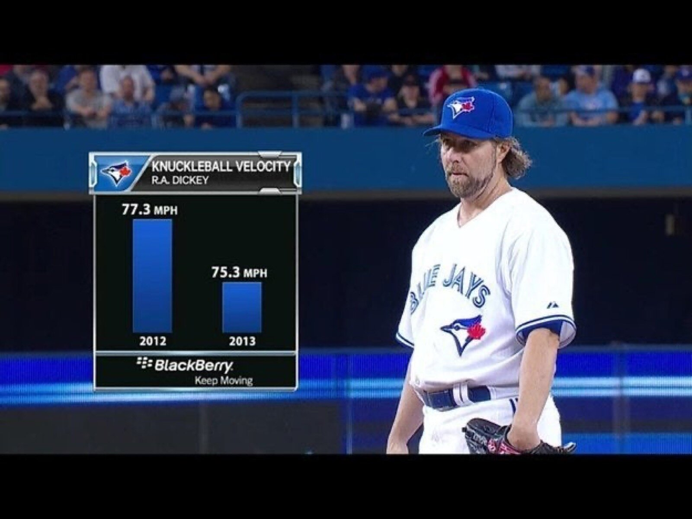
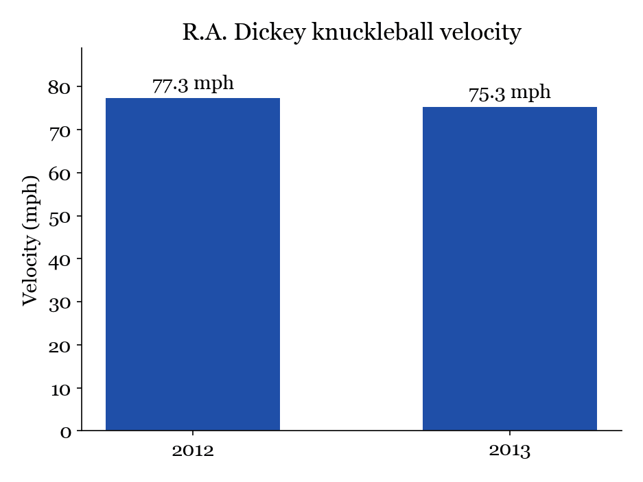
<button onclick="const d=this.parentNode, o=d.querySelector('.orig'), f=d.querySelector('.fixed'), show=f.style.display==='none'; f.style.display=show?'block':'none'; o.style.display=show?'none':'block'; this.textContent=show?'Show original':'Fix y axis';">Fix y axis</button>
</div>
```
:::
::::

[@notopoulos2014]{.caption}

## Two different y-axes

:::: {.columns .vcenter}
::: {.column width="40%"}
::: {.formula style="font-size:0.7em"}
$$\text{lie factor} = \frac{\text{size of effect shown in graph}}{\text{size of effect in data}}$$
:::
:::
::: {.column width="60%"}
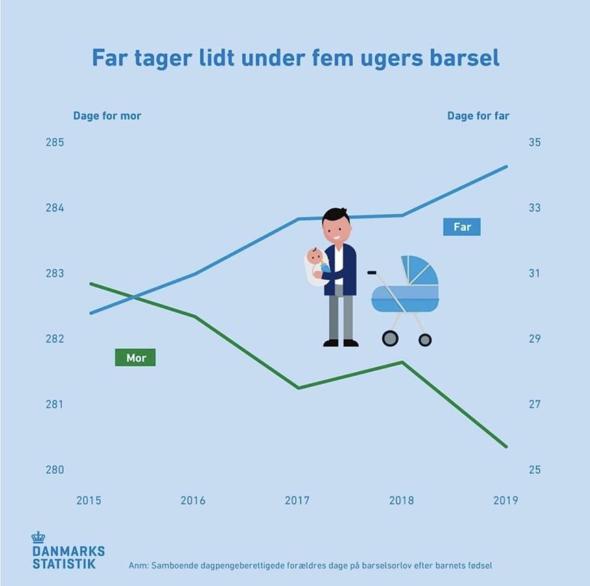{style="height:420px; width:auto; max-width:100%; max-height:none;"}
:::
::::

[@dst]{.caption}

## Tufte's five principles

- Above all else show the data
- Maximize the data-ink ratio
- Erase non-data ink
- Erase redundant data-ink
- Revise and edit

[@tufte2001]{.caption}

## Maximize data density

::: {.formula style="font-size:1.3em"}
$$\text{data density} = \frac{\text{number of data points}}{\text{area of data graphic}}$$
:::

## Low data density

:::: {.columns .vcenter}
::: {.column width="40%"}
::: {.formula style="font-size:0.7em"}
$$\text{data density} = \frac{\text{number of data points}}{\text{area of data graphic}}$$
:::
:::
::: {.column width="60%"}
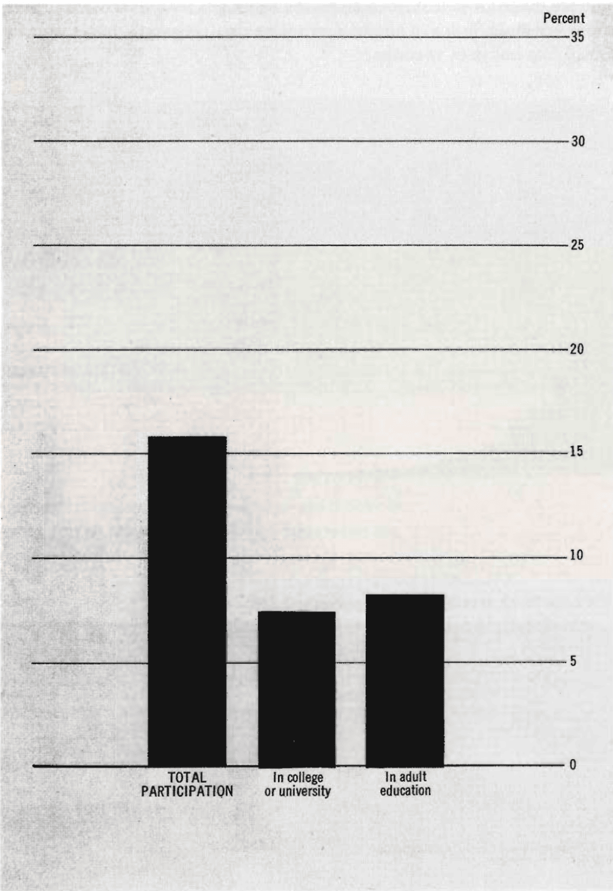{style="height:420px; width:auto; max-width:100%; max-height:none;"}
:::
::::

[0.02 numbers per cm² [@tufte2001]]{.caption}

## High data density

:::: {.columns .vcenter}
::: {.column width="35%"}
::: {.formula style="font-size:0.7em"}
$$\text{data density} = \frac{\text{number of data points}}{\text{area of data graphic}}$$
:::
:::
::: {.column width="65%"}
{style="width:100%; height:auto; max-width:100%; max-height:none;"}
:::
::::

[28 numbers per cm²]{.caption}

## Revision

:::: {.columns}
::: {.column width="50%"}
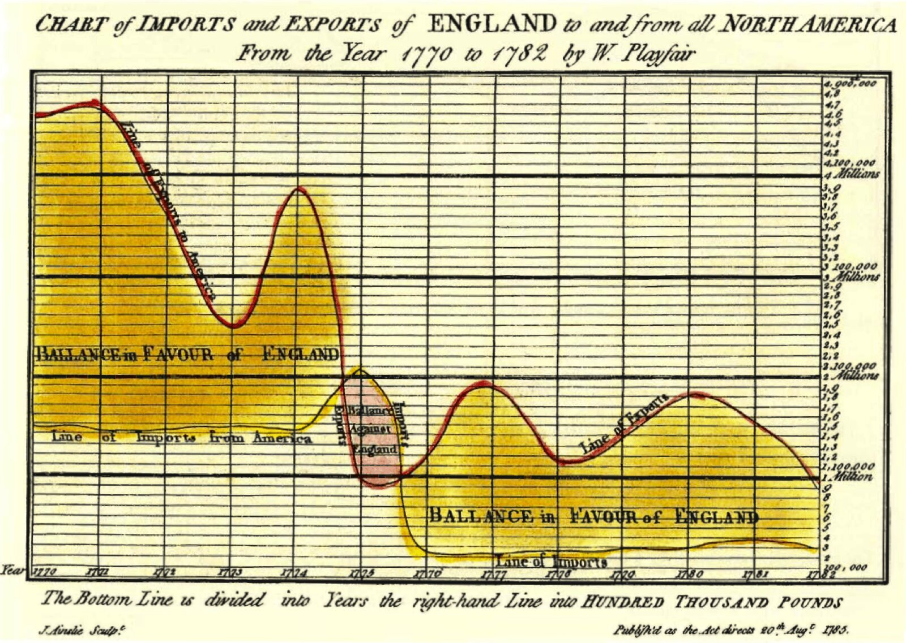

[Playfair (1785)]{.caption}
:::
::: {.column width="50%" .fragment}
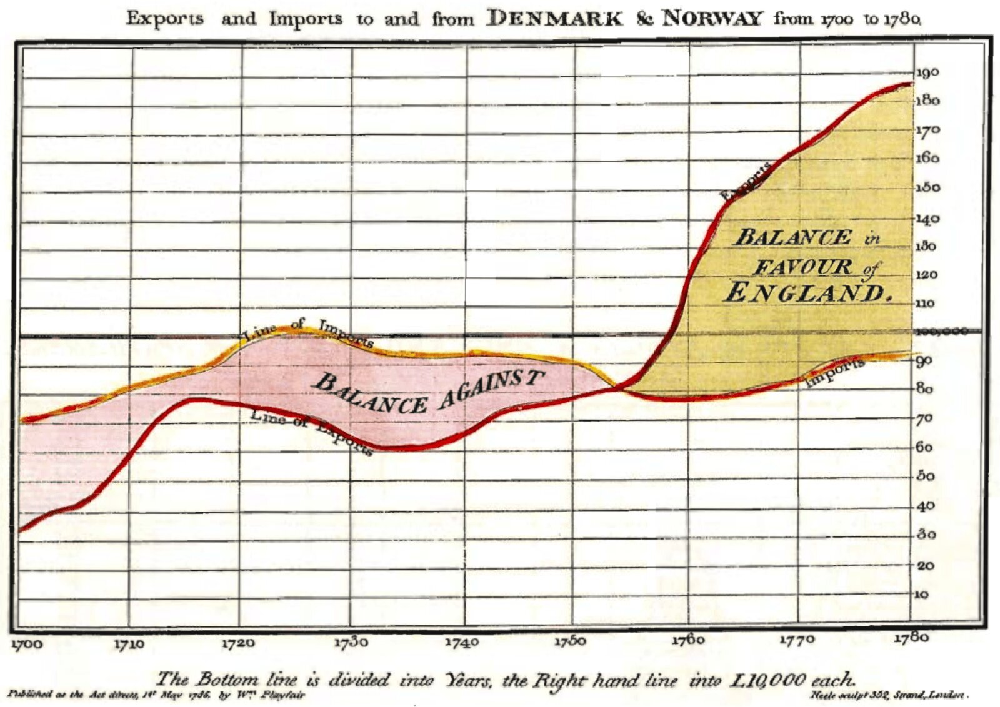

[Playfair (1786)]{.caption}
:::
::::

# Plotting paired data

## Fake data: a Stroop-like experiment

:::: {.columns}
::: {.column width="60%" .codecol}
```python
import numpy as np, pandas as pd
import seaborn as sns
import pingouin as pg

rng = np.random.default_rng(11)
n = 20
base = rng.normal(600, 80, n)   # subjects differ a lot
incon = base + rng.normal(0, 20, n)
con = base - 30 + rng.normal(0, 20, n)  # small, consistent effect

df = pd.DataFrame({"subject": range(n),
                   "Congruent": con,
                   "Incongruent": incon})
# long format: one row per observation
long = df.melt("subject", var_name="condition",
               value_name="rt")

pg.ttest(df.Incongruent, df.Congruent, paired=True)
```
:::
::: {.column width="40%"}
- 20 participants
- Each sees **both** conditions
- Paired *t*-test: *t*(19) = 4.90, *p* < .001
- Mean difference = 23 ms
:::
::::

## Don't do this

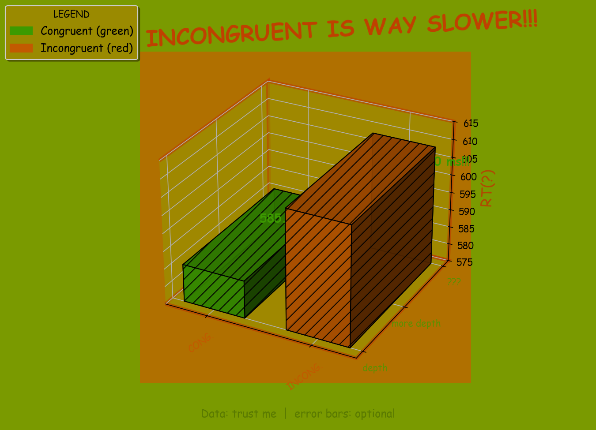{height=560px}

## Bar plot

:::: {.columns}
::: {.column width="50%" .codecol}
```python
pal = {"Congruent": "#4C827B", "Incongruent": "#CD5909"}

sns.barplot(long, x="condition", y="rt",
            hue="condition", palette=pal,
            errorbar="se")
```
:::
::: {.column width="50%"}
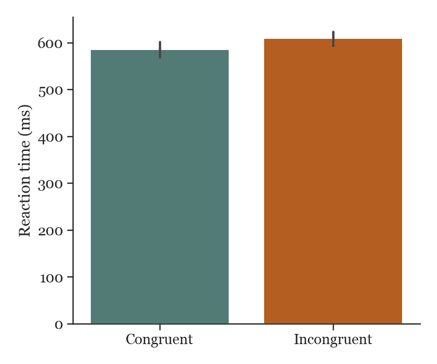

[Means ± SE. Where are the data?]{.caption}
:::
::::

## Bar plot, zoomed in

:::: {.columns}
::: {.column width="50%" .codecol}
```python
pal = {"Congruent": "#4C827B", "Incongruent": "#CD5909"}

ax = sns.barplot(long, x="condition", y="rt",
                 hue="condition", palette=pal,
                 errorbar="se")
ax.set(ylim=(560, 640))
```
:::
::: {.column width="50%"}
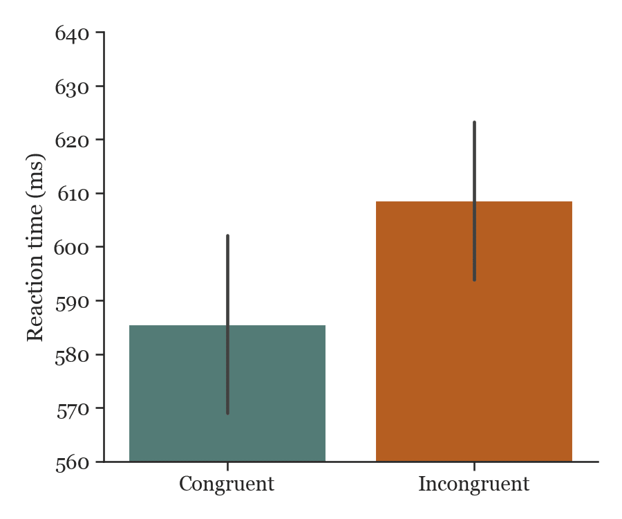

[Same data. Lie factor?]{.caption}
:::
::::

## Box plot

:::: {.columns}
::: {.column width="50%" .codecol}
```python
pal = {"Congruent": "#4C827B", "Incongruent": "#CD5909"}

sns.boxplot(long, x="condition", y="rt",
            hue="condition", palette=pal,
            width=0.5)
```
:::
::: {.column width="50%"}
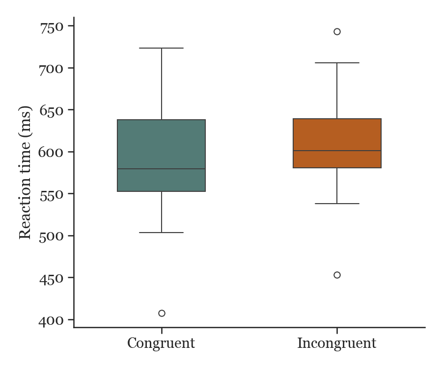

[Shows distributions, but hides within-participant effects]{.caption}
:::
::::

## Violin + strip plot

:::: {.columns}
::: {.column width="50%" .codecol}
```python
pal = {"Congruent": "#4C827B", "Incongruent": "#CD5909"}

sns.violinplot(long, x="condition", y="rt",
               hue="condition", palette=pal,
               inner=None, alpha=0.3)
sns.stripplot(long, x="condition", y="rt",
              hue="condition", palette=pal,
              size=7, jitter=0.08)
```
:::
::: {.column width="50%"}
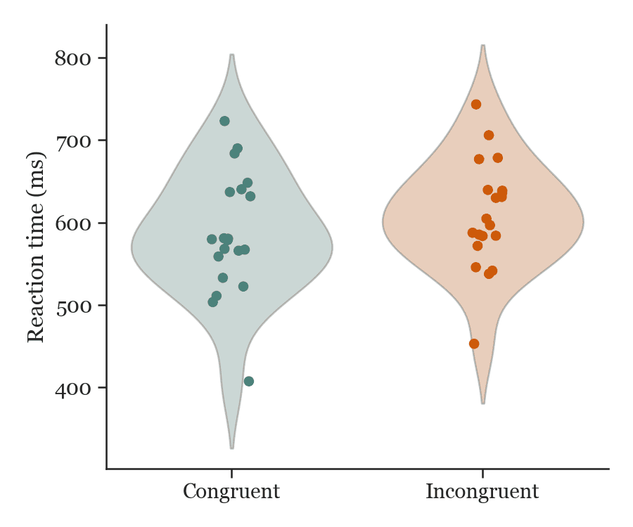

[All the data, but also hides within-participant differences]{.caption}
:::
::::

## Paired lines

:::: {.columns}
::: {.column width="50%" .codecol}
```python
pal = {"Congruent": "#4C827B", "Incongruent": "#CD5909"}

# one grey line per subject
sns.lineplot(long, x="condition", y="rt",
             units="subject", estimator=None,
             color="#9ca0b0", lw=1)
sns.stripplot(long, x="condition", y="rt",
              hue="condition", palette=pal,
              size=7, jitter=False)
# group means ± SE
sns.pointplot(long, x="condition", y="rt",
              color="black", errorbar="se",
              markers="D")
```
:::
::: {.column width="50%"}
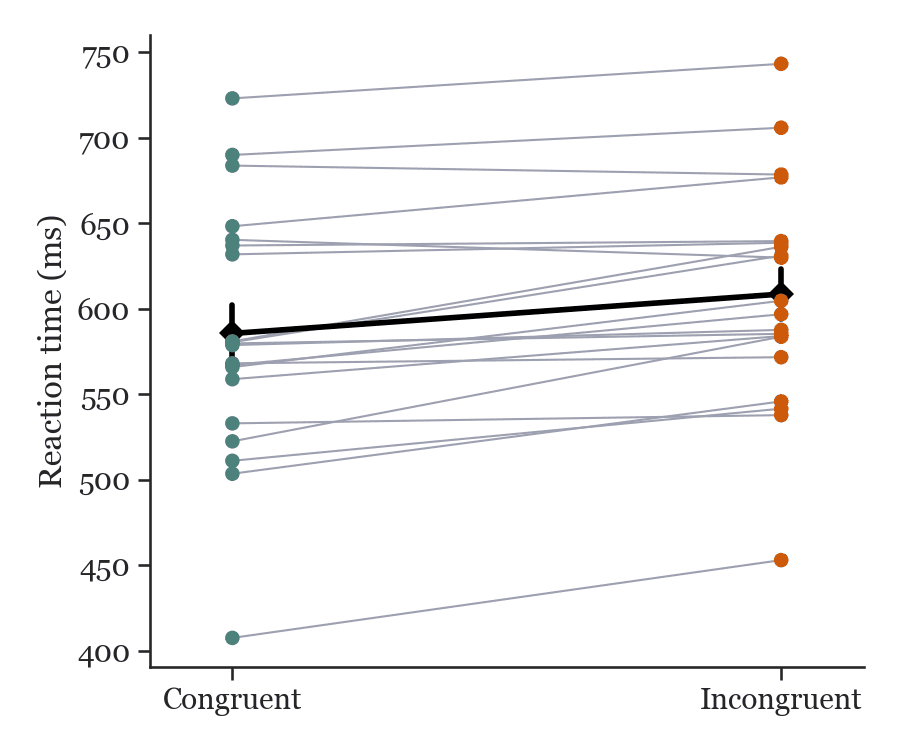

[Now the pairing is visible: most lines go up]{.caption}
:::
::::

## Paired lines, with and without violins

:::: {.columns}
::: {.column width="50%"}

:::
::: {.column width="50%"}
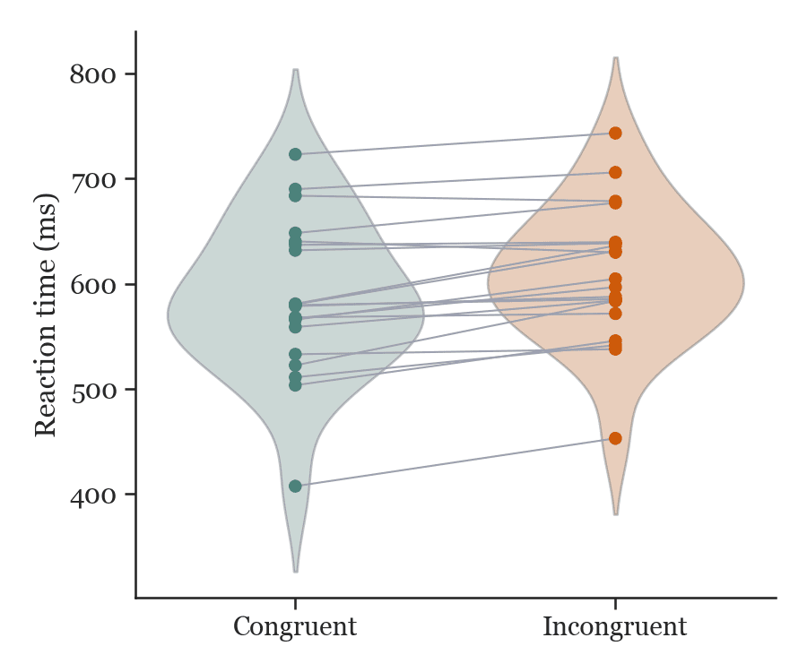
:::
::::

<details class="codebox"><summary>Code for violin + lines</summary>
```python
sns.violinplot(long, x="condition", y="rt",
               hue="condition", palette=pal,
               inner=None, alpha=0.3)
sns.lineplot(long, x="condition", y="rt",
             units="subject", estimator=None,
             color="#9ca0b0", lw=1)
sns.stripplot(long, x="condition", y="rt",
              hue="condition", palette=pal,
              size=7, jitter=False)
```
</details>

## Three ways to show the pairing

:::: {.columns}
::: {.column width="33%"}


[Paired lines]{.caption}
:::
::: {.column width="33%"}


[Violin + lines]{.caption}
:::
::: {.column width="33%"}
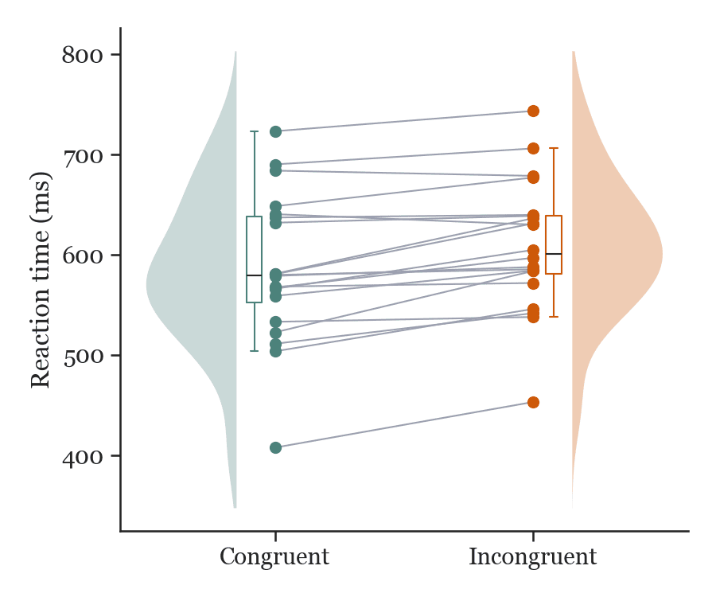

[Raincloud]{.caption}
:::
::::

## Scatter against the identity line

:::: {.columns}
::: {.column width="50%" .codecol}
```python
below = df.Incongruent < df.Congruent
ax = sns.scatterplot(df, x="Congruent",
                     y="Incongruent", hue=below,
                     palette={False: "#1e66f5",
                              True: "#d20f39"},
                     s=70, legend=False)
lo, hi = 390, 765
ax.plot([lo, hi], [lo, hi],
        color="#9ca0b0", ls="--")   # y = x
ax.set(xlim=(lo, hi), ylim=(lo, hi),
       aspect="equal")
```
:::
::: {.column width="50%"}
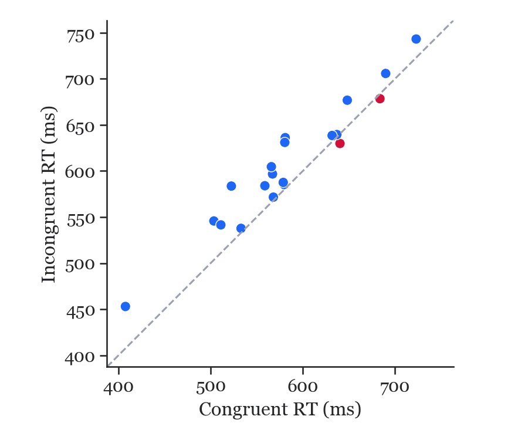

[Points above the line: slower when incongruent]{.caption}
:::
::::

## Difference scores

:::: {.columns}
::: {.column width="50%" .codecol}
```python
diff = df.Incongruent - df.Congruent

sns.stripplot(y=diff, color="#1e66f5",
              size=7, jitter=0.08)
# mean difference with 95% CI
ax = sns.pointplot(y=diff, color="#CD5909",
                   errorbar=("ci", 95),
                   markers="D")
ax.axhline(0, color="#9ca0b0", ls="--")
```
:::
::: {.column width="50%"}
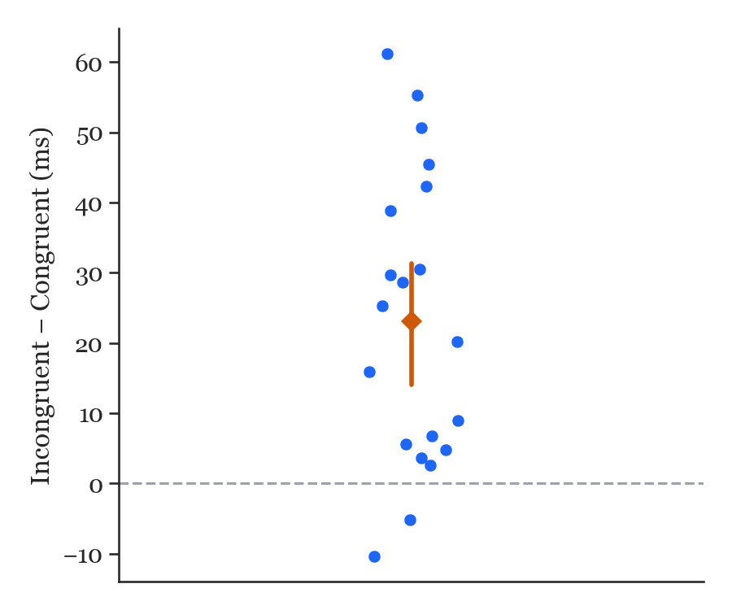

[What the paired t-test actually tests, but maybe less intuitive to read?]{.caption}
:::
::::


# Reading figures

## Which test?

::: {.testtable}
| Test | When to use it |
|------|----------------|
| Paired *t*-test | Two conditions, **same** participants in both; continuous outcome |
| Independent *t*-test | Two groups of **different** participants; continuous outcome |
| One-way ANOVA | Three or more groups (one factor); continuous outcome |
| Two-way ANOVA | Two factors at once; tests each main effect and their interaction |
| Linear regression | Continuous outcome predicted by one or more continuous (or categorical) predictors |
| Logistic regression | Binary outcome (0/1, yes/no, correct/incorrect) predicted by one or more continuous (or categorical) predictors |
:::

## Paired *t*-test

:::: {.columns}
::: {.column width="70%"}
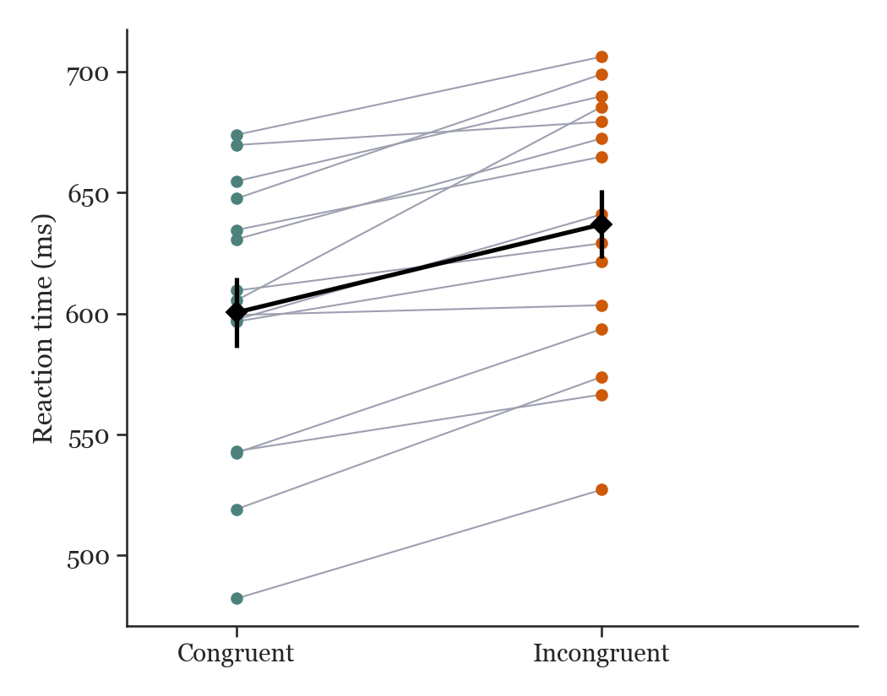{style="height:470px; width:auto; max-width:none; max-height:none;"}
:::
::: {.column width="30%" .plotstack}


:::
::::

[Same people, different conditions]{.caption}

## Independent *t*-test

:::: {.columns}
::: {.column width="60%"}
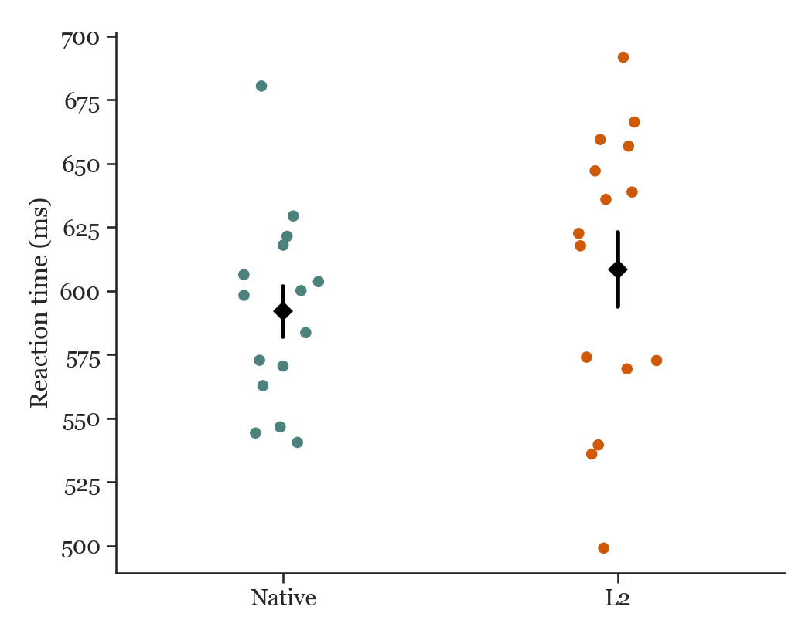{style="height:440px; width:auto; max-width:100%; max-height:none;"}
:::
::: {.column width="40%" .testdesc}
- Two groups of **different** participants
- Continuous outcome
:::
::::

[Different people in each group.]{.caption}

## One-way ANOVA

:::: {.columns}
::: {.column width="60%"}
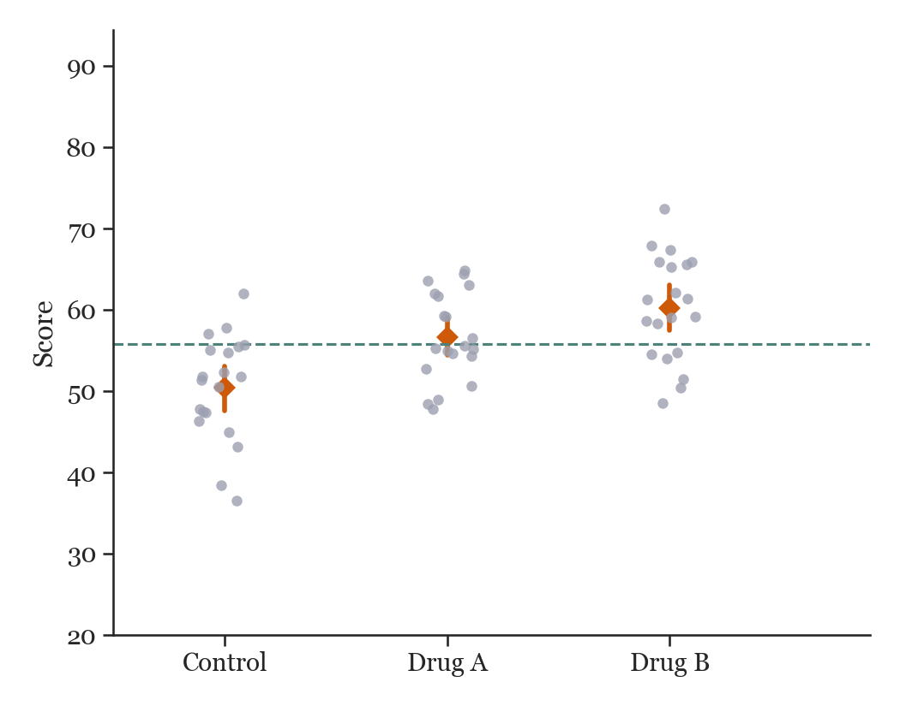{style="height:440px; width:auto; max-width:100%; max-height:none;"}
:::
::: {.column width="40%" .testdesc}
- Three or more groups (one factor)
- Continuous outcome
:::
::::

[Do the group means differ more than the noise within groups?]{.caption}

## Two-way ANOVA

:::: {.columns}
::: {.column width="60%"}
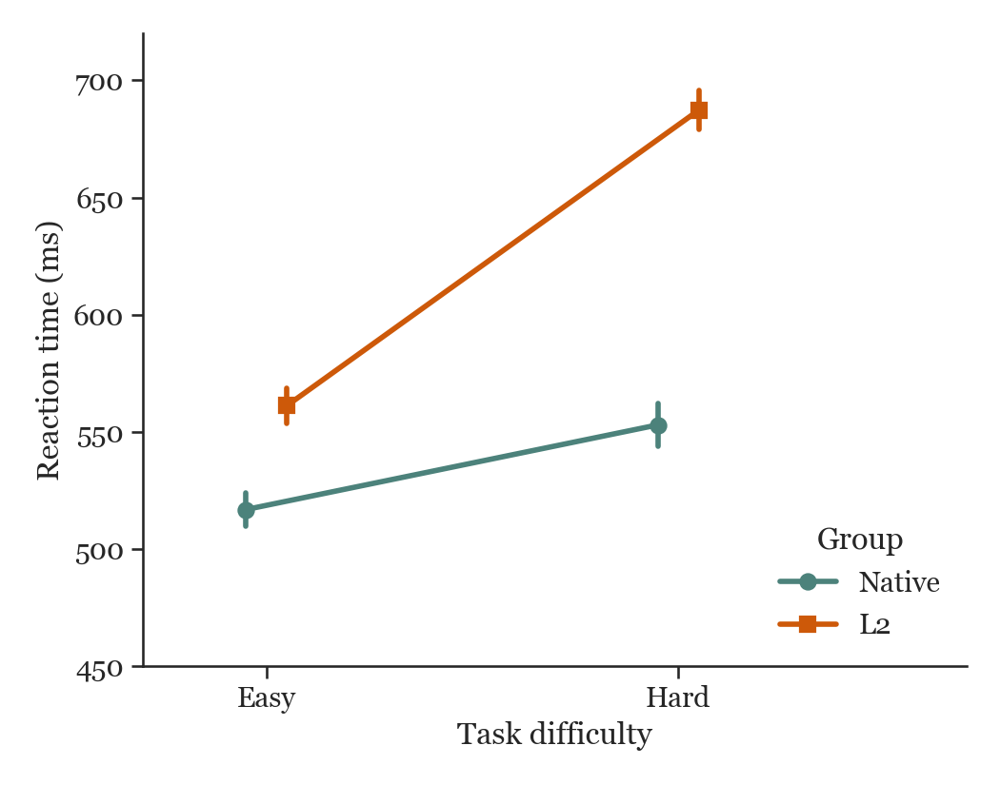{style="height:440px; width:auto; max-width:100%; max-height:none;"}
:::
::: {.column width="40%" .testdesc}
- Two factors at once
- Tests each main effect and their interaction
:::
::::

[Two main effects + an interaction]{.caption}

## Linear regression

:::: {.columns}
::: {.column width="60%"}
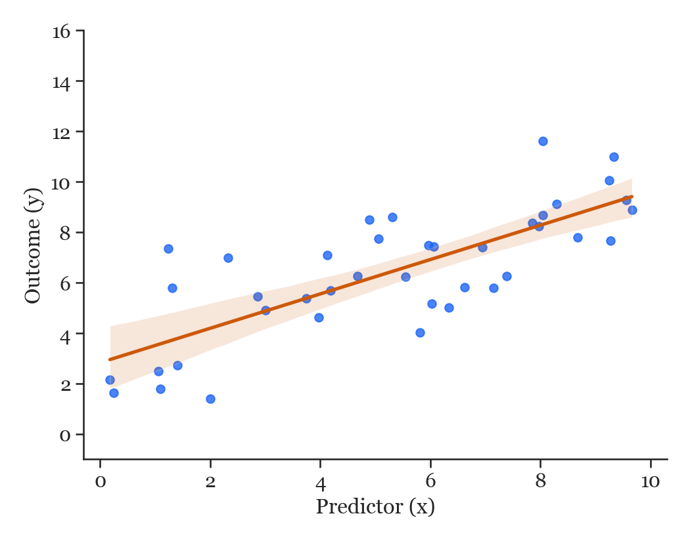{style="height:440px; width:auto; max-width:100%; max-height:none;"}
:::
::: {.column width="40%" .testdesc}
- Continuous outcome
- One or more continuous (or categorical) predictors
:::
::::

[How much does *y* change per unit of *x*?]{.caption}

## Logistic regression

:::: {.columns}
::: {.column width="60%"}
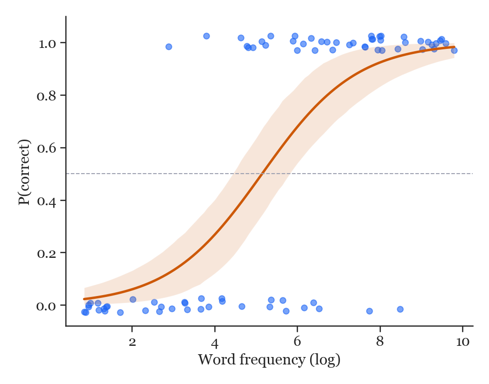{style="height:440px; width:auto; max-width:100%; max-height:none;"}
:::
::: {.column width="40%" .testdesc}
- Binary outcome (0/1, yes/no, correct/incorrect)
- One or more continuous (or categorical) predictors
:::
::::

[How does the probability of a 1 change with *x*?]{.caption}


## Categorical predictors

:::: {.columns}
::: {.column width="50%"}
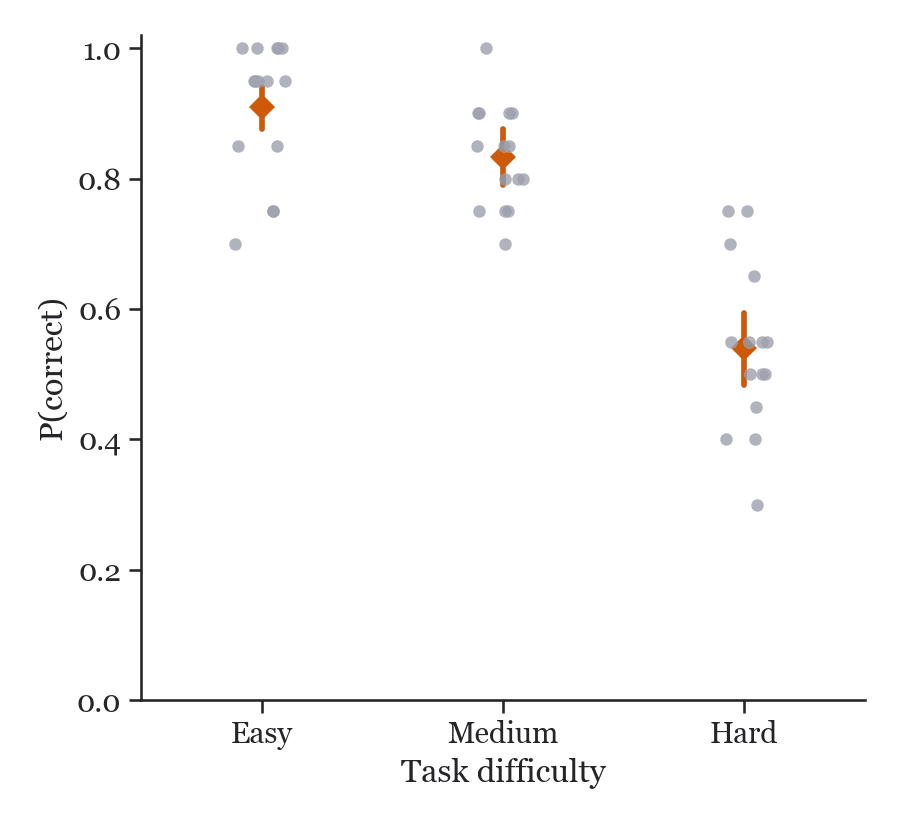{style="height:420px; width:auto; max-width:100%; max-height:none;"}

[One factor (grey = one participant)]{.caption}
:::
::: {.column width="50%"}
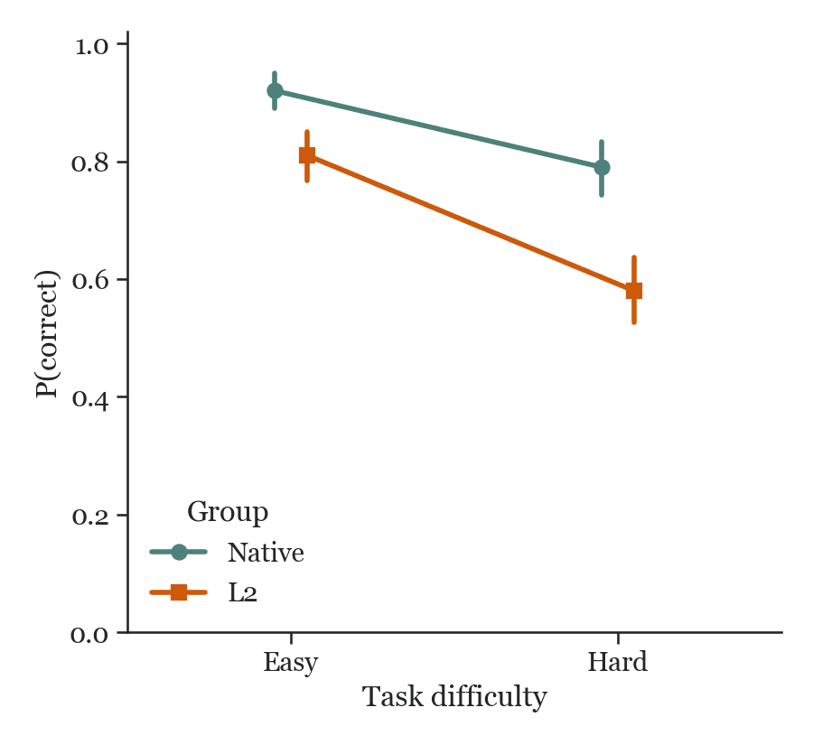{style="height:420px; width:auto; max-width:100%; max-height:none;"}

[Two factors]{.caption}
:::
::::

# References

## References {.scrollable}

::: {#refs}
:::
