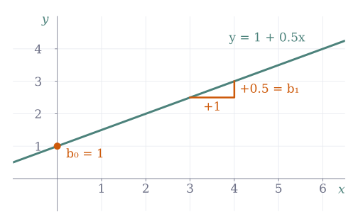
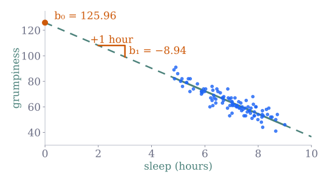
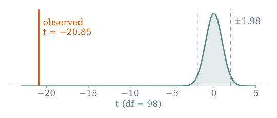
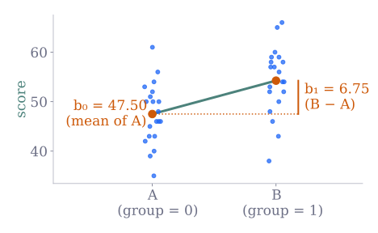

# Modelling our data as a line

## The equation of a line

::: {.formula style="font-size:0.7em"}
$$y = b_0 + b_1 x$$
:::

{width="65%"}

[*b*~0~: intercept (value of *y* at *x* = 0) · *b*~1~: slope (change in *y* per 1 unit of *x*)]{.caption}

## Finding the best-fitting line

```{=html}
<iframe src="fit_demo.html" style="width:100%; height:560px; border:1px solid var(--ctp-surface2); border-radius:10px; background:white;"></iframe>
```

## Sleep and grumpiness

```{=html}
<iframe src="sleep_code_demo.html" style="width:100%; height:560px; border:1px solid var(--ctp-surface2); border-radius:10px; background:white;"></iframe>
```
# Reading the output

## Reading the output

```{=html}
<table class="pgout">
<thead><tr><th>names</th><th class="est">coef</th><th class="unc">se</th><th class="tst">T</th><th class="tst">pval</th><th class="fit">r2</th><th class="fit">adj_r2</th><th class="unc">CI[2.5%]</th><th class="unc">CI[97.5%]</th></tr></thead>
<tbody>
<tr><td>Intercept</td><td>125.956</td><td>3.016</td><td>41.762</td><td>0.000</td><td>0.816</td><td>0.814</td><td>119.971</td><td>131.942</td></tr>
<tr><td>dan_sleep</td><td>−8.937</td><td>0.429</td><td>−20.854</td><td>0.000</td><td>0.816</td><td>0.814</td><td>−9.787</td><td>−8.086</td></tr>
</tbody>
</table>
<p class="legend"><span class="est">estimate</span> · <span class="unc">uncertainty</span> · <span class="tst">test</span> · <span class="fit">fit</span></p>
```

::: {.formula style="font-size:0.7em"}
$$\hat{y} = b_0 + b_1 x$$
:::

[One row per term: the intercept *b*~0~ and the slope *b*~1~]{.caption}

## `coef`: intercept and slope

{width="58%"}

::: {.formula style="font-size:0.6em"}
$$\widehat{\text{grump}} = 125.96 - 8.94 \times \text{sleep}$$
:::

[Notice: the intercept is an extrapolation]{.caption}

```{=html}
<table class="pgmini"><thead><tr><th>names</th><th class="hl">coef</th><th>se</th><th>T</th><th>pval</th><th>r2</th><th>adj_r2</th><th>CI[2.5%]</th><th>CI[97.5%]</th></tr></thead><tbody><tr><td>Intercept</td><td class="hl">125.956</td><td>3.016</td><td>41.762</td><td>0.000</td><td>0.816</td><td>0.814</td><td>119.971</td><td>131.942</td></tr><tr><td>dan_sleep</td><td class="hl">−8.937</td><td>0.429</td><td>−20.854</td><td>0.000</td><td>0.816</td><td>0.814</td><td>−9.787</td><td>−8.086</td></tr></tbody></table>
```

## Where `coef` comes from

::: {.formula style="font-size:0.55em"}
$$b_1 = \frac{\sum (x_i - \bar{x})(y_i - \bar{y})}{\sum (x_i - \bar{x})^2} \qquad b_0 = \bar{y} - b_1 \bar{x}$$
:::

```{=html}
<iframe src="sleep_fit_demo.html" style="width:100%; height:400px; border:1px solid var(--ctp-surface2); border-radius:10px; background:white;"></iframe>
```

```{=html}
<table class="pgmini"><thead><tr><th>names</th><th class="hl">coef</th><th>se</th><th>T</th><th>pval</th><th>r2</th><th>adj_r2</th><th>CI[2.5%]</th><th>CI[97.5%]</th></tr></thead><tbody><tr><td>Intercept</td><td class="hl">125.956</td><td>3.016</td><td>41.762</td><td>0.000</td><td>0.816</td><td>0.814</td><td>119.971</td><td>131.942</td></tr><tr><td>dan_sleep</td><td class="hl">−8.937</td><td>0.429</td><td>−20.854</td><td>0.000</td><td>0.816</td><td>0.814</td><td>−9.787</td><td>−8.086</td></tr></tbody></table>
```

## `se`: how much does [*b*~1~]{style="text-transform:none"} vary?

```{=html}
<iframe src="se_demo.html" style="width:100%; height:440px; border:1px solid var(--ctp-surface2); border-radius:10px; background:white;"></iframe>
```

```{=html}
<table class="pgmini"><thead><tr><th>names</th><th>coef</th><th class="hl">se</th><th>T</th><th>pval</th><th>r2</th><th>adj_r2</th><th>CI[2.5%]</th><th>CI[97.5%]</th></tr></thead><tbody><tr><td>Intercept</td><td>125.956</td><td class="hl">3.016</td><td>41.762</td><td>0.000</td><td>0.816</td><td>0.814</td><td>119.971</td><td>131.942</td></tr><tr><td>dan_sleep</td><td>−8.937</td><td class="hl">0.429</td><td>−20.854</td><td>0.000</td><td>0.816</td><td>0.814</td><td>−9.787</td><td>−8.086</td></tr></tbody></table>
```


## `T` and `pval`: is [*b*~1~]{style="text-transform:none"} ≠ 0?

::: {.formula style="font-size:0.6em"}
$$t = \frac{b_1}{SE(b_1)} = \frac{-8.937}{0.429} = -20.85 \qquad df = N - 2 = 98$$
:::

{width="60%"}

[`pval` = 0.0 means *p* < .0005, not *p* = 0 (here *p* ≈ 8 × 10^−38^).
The *p*-value of the intercept is usually not very meaningful.]{.caption}

```{=html}
<table class="pgmini"><thead><tr><th>names</th><th>coef</th><th>se</th><th class="hl">T</th><th class="hl">pval</th><th>r2</th><th>adj_r2</th><th>CI[2.5%]</th><th>CI[97.5%]</th></tr></thead><tbody><tr><td>Intercept</td><td>125.956</td><td>3.016</td><td class="hl">41.762</td><td class="hl">0.000</td><td>0.816</td><td>0.814</td><td>119.971</td><td>131.942</td></tr><tr><td>dan_sleep</td><td>−8.937</td><td>0.429</td><td class="hl">−20.854</td><td class="hl">0.000</td><td>0.816</td><td>0.814</td><td>−9.787</td><td>−8.086</td></tr></tbody></table>
```

## `CI[2.5%]` and `CI[97.5%]`

::: {.formula style="font-size:0.55em"}
$$b_1 \pm t_{.975,\,98} \times SE(b_1) = -8.94 \pm 1.98 \times 0.429 = [-9.79,\ -8.09]$$
:::

```{=html}
<iframe src="ci_demo.html" style="width:100%; height:400px; border:1px solid var(--ctp-surface2); border-radius:10px; background:white;"></iframe>
```

```{=html}
<table class="pgmini"><thead><tr><th>names</th><th>coef</th><th>se</th><th>T</th><th>pval</th><th>r2</th><th>adj_r2</th><th class="hl">CI[2.5%]</th><th class="hl">CI[97.5%]</th></tr></thead><tbody><tr><td>Intercept</td><td>125.956</td><td>3.016</td><td>41.762</td><td>0.000</td><td>0.816</td><td>0.814</td><td class="hl">119.971</td><td class="hl">131.942</td></tr><tr><td>dan_sleep</td><td>−8.937</td><td>0.429</td><td>−20.854</td><td>0.000</td><td>0.816</td><td>0.814</td><td class="hl">−9.787</td><td class="hl">−8.086</td></tr></tbody></table>
```

## `r2`: variance explained

::: {.formula style="font-size:0.55em"}
$$R^2 = 1 - \frac{SS_{res}}{SS_{tot}} = 1 - \frac{\sum (y_i - \hat{y}_i)^2}{\sum (y_i - \bar{y})^2} = 1 - \frac{1838.7}{9998.6} = 0.816$$
:::

```{=html}
<iframe src="r2_demo.html" style="width:100%; height:370px; border:1px solid var(--ctp-surface2); border-radius:10px; background:white;"></iframe>
```

[With one predictor, *R*^2^ = *r*^2^: `pg.corr(x, y)` gives *r* = −0.903, and (−0.903)^2^ = 0.816]{.caption}

```{=html}
<table class="pgmini"><thead><tr><th>names</th><th>coef</th><th>se</th><th>T</th><th>pval</th><th class="hl">r2</th><th>adj_r2</th><th>CI[2.5%]</th><th>CI[97.5%]</th></tr></thead><tbody><tr><td>Intercept</td><td>125.956</td><td>3.016</td><td>41.762</td><td>0.000</td><td class="hl">0.816</td><td>0.814</td><td>119.971</td><td>131.942</td></tr><tr><td>dan_sleep</td><td>−8.937</td><td>0.429</td><td>−20.854</td><td>0.000</td><td class="hl">0.816</td><td>0.814</td><td>−9.787</td><td>−8.086</td></tr></tbody></table>
```

## `adj_r2`: penalising predictors

::: {.formula style="font-size:0.6em"}
$$R^2_{adj} = 1 - (1 - R^2)\,\frac{N - 1}{N - p - 1} = 1 - (1 - 0.816)\,\frac{99}{98} = 0.814$$
:::

- *p* = number of predictors (here 1)
- Adding a predictor never lowers *R*^2^; *R*^2^~adj~ only rises if it helps enough
- It can be negative (either *R*^2^ is basically 0, or the model has too many parameters)

```{=html}
<table class="pgmini"><thead><tr><th>names</th><th>coef</th><th>se</th><th>T</th><th>pval</th><th>r2</th><th class="hl">adj_r2</th><th>CI[2.5%]</th><th>CI[97.5%]</th></tr></thead><tbody><tr><td>Intercept</td><td>125.956</td><td>3.016</td><td>41.762</td><td>0.000</td><td>0.816</td><td class="hl">0.814</td><td>119.971</td><td>131.942</td></tr><tr><td>dan_sleep</td><td>−8.937</td><td>0.429</td><td>−20.854</td><td>0.000</td><td>0.816</td><td class="hl">0.814</td><td>−9.787</td><td>−8.086</td></tr></tbody></table>
```

## Your turn

```{=html}
<iframe src="pycode_demo.html" style="width:100%; height:560px; border:1px solid var(--ctp-surface2); border-radius:10px; background:white;"></iframe>
```

# One more thing...

## The t-test is also a linear regression 🤯

::: {.formula style="font-size:0.6em"}
$$\text{score} = b_0 + b_1 \times \text{group} \qquad \text{group} = 0 \text{ (A) or } 1 \text{ (B)}$$
:::

:::: {.columns}
::: {.column width="55%"}
```{=html}

```
:::
::: {.column width="45%"}
```{=html}
<div class="cmp">
<div class="cmphead">pg.ttest(B, A, correction=False)</div>
<table class="pgmini"><thead><tr><th class="hl">T</th><th>dof</th><th>p-val</th></tr></thead>
<tbody><tr><td class="hl">3.237</td><td>38</td><td>0.0025</td></tr></tbody></table>
<div class="cmphead">pg.linear_regression(df['group'], df['score'])</div>
<table class="pgmini"><thead><tr><th>names</th><th>coef</th><th class="hl">T</th><th>pval</th></tr></thead>
<tbody><tr><td>Intercept</td><td>47.50</td><td>32.210</td><td>0.000</td></tr>
<tr><td>group</td><td>6.75</td><td class="hl">3.237</td><td>0.0025</td></tr></tbody></table>
</div>
```
:::
::::

[Same *t*, same *df* = *N* − 2 = 38, same *p*: testing *b*~1~ = 0 *is* testing whether the group means differ (Student's t-test, equal variances; simulated data)]{.caption}
