# Reading

## A sixth sense

:::: {.columns}
::: {.column width="60%"}
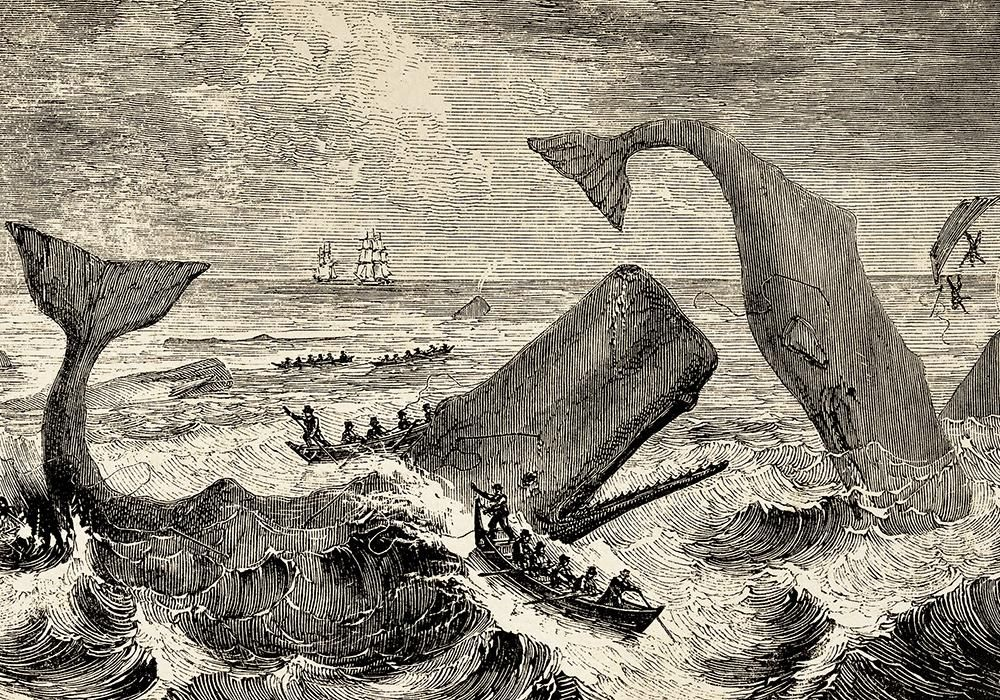{width="95%"}
:::
::: {.column width="40%"}
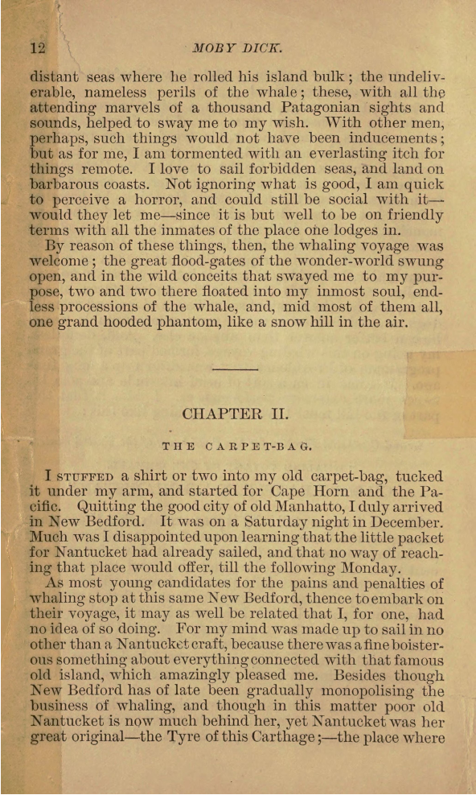{width="70%"}
:::
::::

## A sixth sense

:::: {.columns}
::: {.column width="60%"}
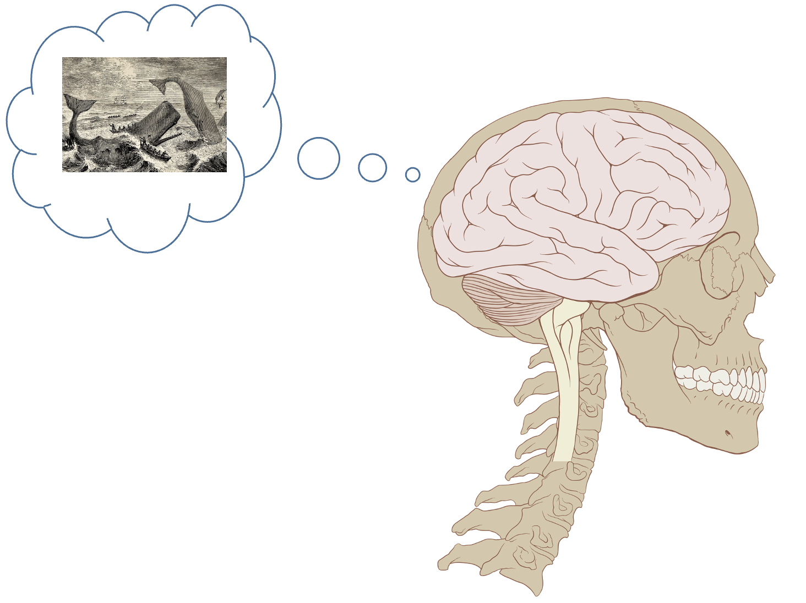{width="95%"}
:::
::: {.column width="40%"}
{width="70%"}
:::
::::

## Visual Word Form Area

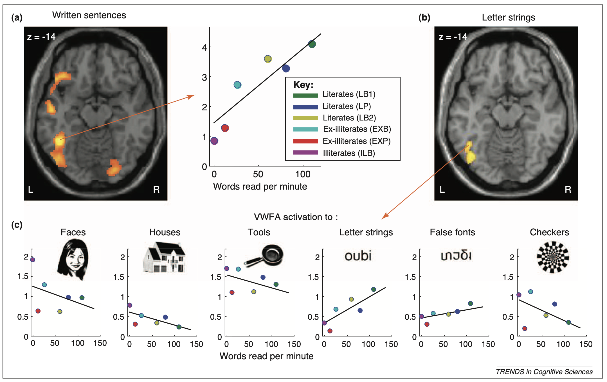{width="75%"}

[@dehaeneUniqueRoleVisual2011]{.caption}

## Simple View of Reading

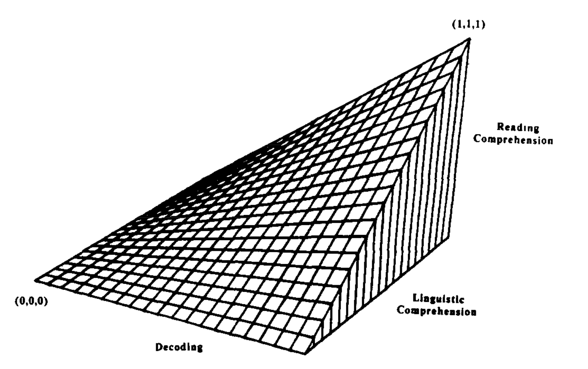{width="70%"}

[@hooverSimpleViewReading1990]{.caption}

## Decoding

:::: {.columns}
::: {.column width="55%"}
{width="95%"}
:::
::: {.column width="45%"}
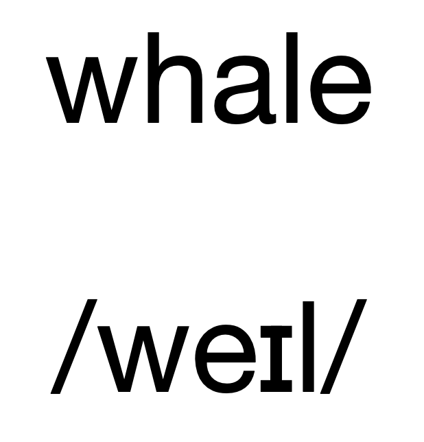{width="85%"}
:::
::::

## Linguistic comprehension

:::: {.columns}
::: {.column width="55%"}
- Syntax
- Morphology
- Semantics
- (World knowledge)
- (Literary knowledge)
:::
::: {.column width="45%"}
{width="60%"}
:::
::::

## Discourse comprehension

:::: {.columns}
::: {.column width="55%"}
{width="95%"}
:::
::: {.column width="45%"}
- Structure-building [@gernsbacherStructureBuilding]
- Situation models [@zwaanSituationModelsLanguage]
- Relies on world knowledge
- Relies on memory
- Relies on attention
:::
::::

# Reading Comprehension

## Reading Systems Framework

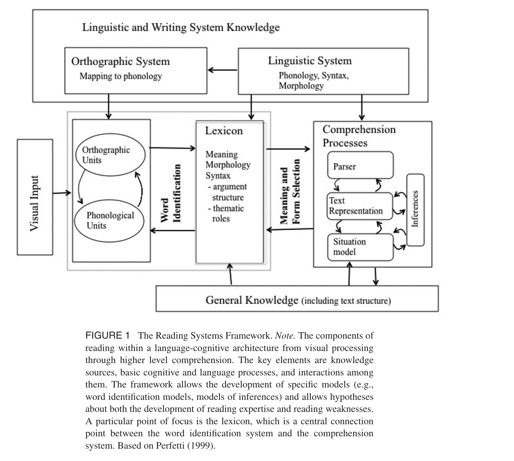{height="520px"}

[@perfettiWordKnowledgeTheory2014]{.caption}

## Situation models

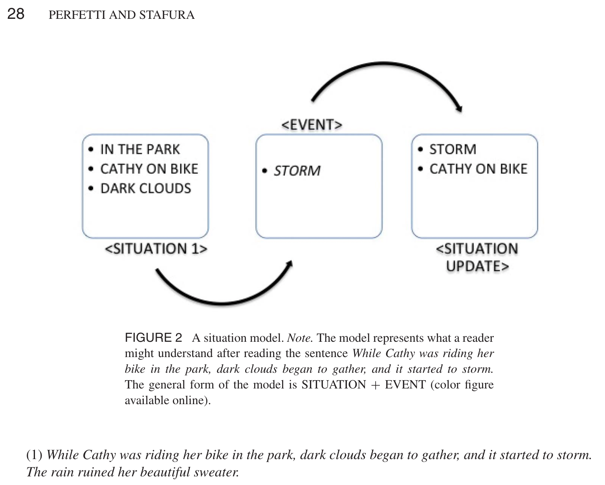{height="520px"}

[@perfettiWordKnowledgeTheory2014]{.caption}

## Word-to-text integration

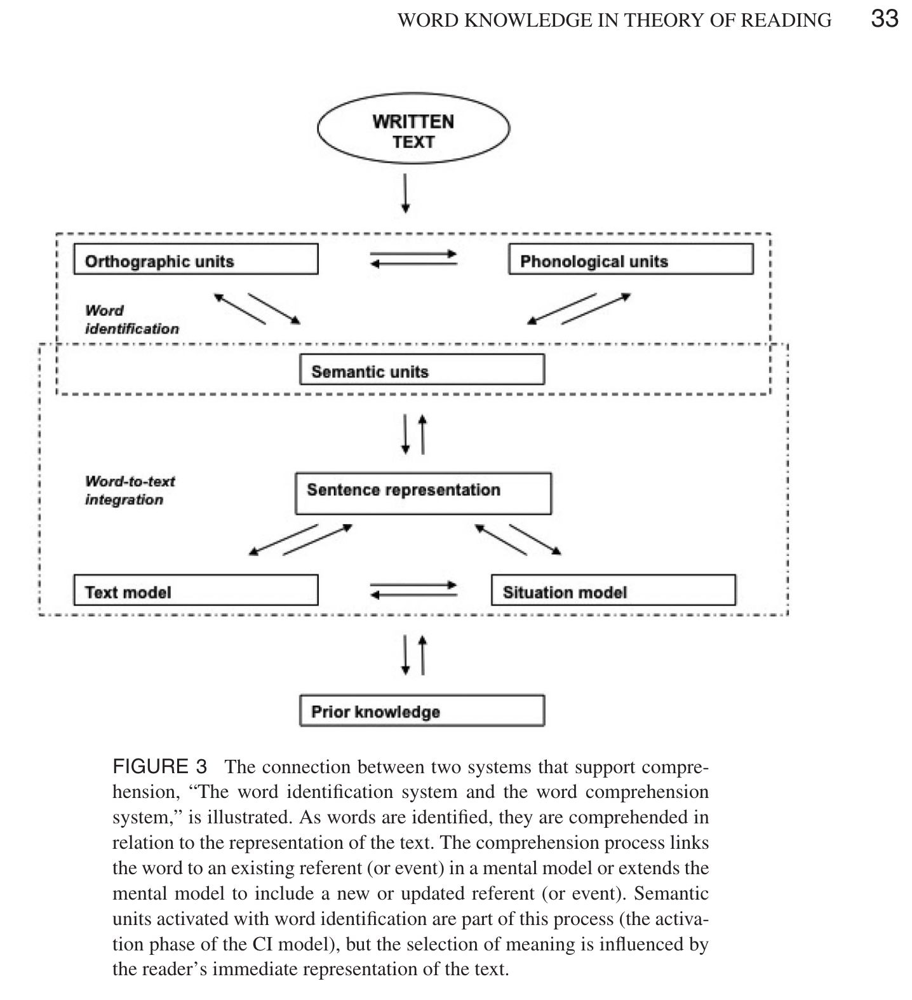{height="520px"}

[@perfettiWordKnowledgeTheory2014]{.caption}

## Reading comprehension

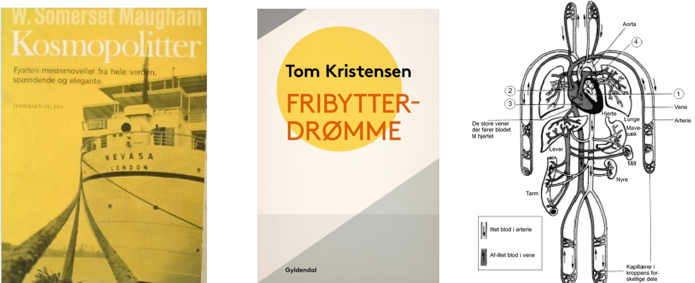{width="100%"}
[@arnbakLaeseteksterGymnasiumHf2000]{.caption}


## Inference from world knowledge

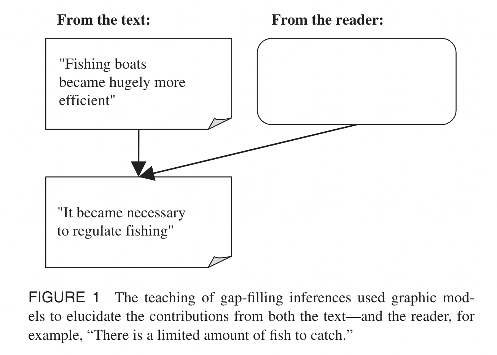{width="65%"}

[@elbroActivationBackgroundKnowledge2013]{.caption}


## Cloze tasks

- Measure of readability [@taylorClozeProcedureNew1953]
- "Please pass the ____." (salt/sodium chloride/blowtorch)
- "I heard a ___ bark." (dog/seal)

## "Deep" cloze

:::: {.columns}
::: {.column width="30%"}
[The men carried the [table, coffin, drawers, children]. They passed many bouquets of flowers as they slowly made their way down the aisle. They were invited for tea at a close relative's house afterwards.]{style="font-size:0.6em"}
:::
::: {.column width="70%"}
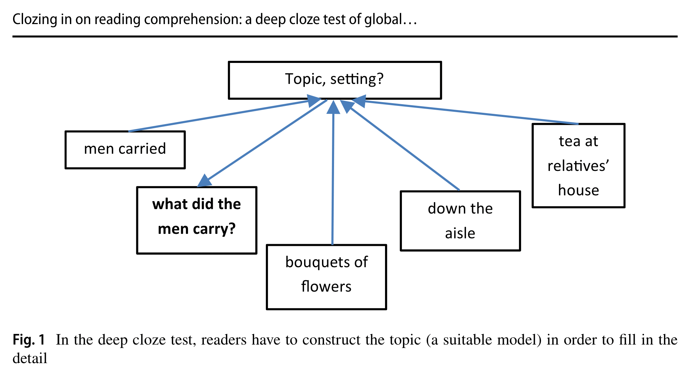{width="100%"}
:::
::::

[@jensenClozingReadingComprehension2022]{.caption}


## A surprisingly high correlation

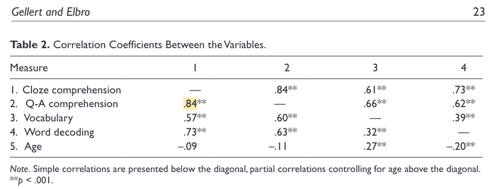{width="100%"}
[@gellertClozeTestsMay2013]{.caption}

## A deep cloze test

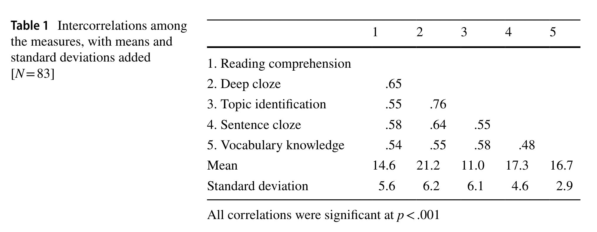{width="90%"}

[@jensenClozingReadingComprehension2022]{.caption}

## A deep cloze test

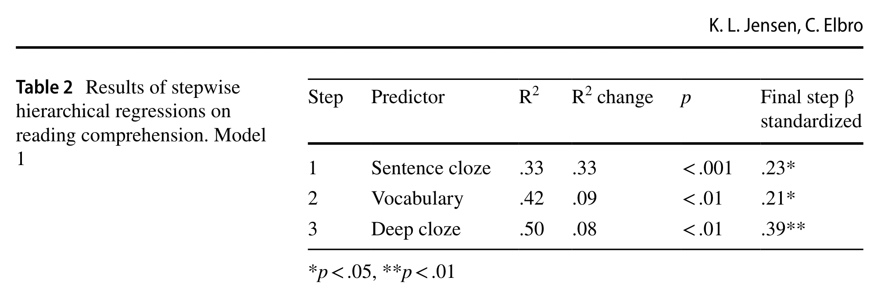{width="90%"}

[@jensenClozingReadingComprehension2022]{.caption}

## Replications

```{=html}
<table class="cloze">
<thead><tr><th>Author</th><th>Q &amp; A test</th><th><em>r</em></th><th><em>p</em></th><th><em>n</em></th><th>Notes</th></tr></thead>
<tbody>
<tr class="fragment"><td>Gellert &amp; Elbro (2013)</td><td>Læsetekster for Unge og Voksne</td><td>0.84</td><td>&lt; 0.001</td><td>204</td><td>Weaker adult readers</td></tr>
<tr class="fragment"><td>Storgaard (2016)</td><td>Læsetekster for Unge og Voksne</td><td>0.423</td><td>&lt; 0.05</td><td>29</td><td>University students</td></tr>
<tr class="fragment"><td>Ravn Claumarch (2017)</td><td>Læsetekster for gymnasium, hf mv.</td><td>0.682</td><td>&lt; 0.001</td><td>41</td><td>University students</td></tr>
<tr class="fragment"><td>Weed (2019)</td><td>Læsetekster for gymnasium, hf mv.</td><td>0.253</td><td>&lt; 0.05</td><td>95</td><td>University students</td></tr>
<tr class="fragment"><td>Lyskov Jensen &amp; Elbro (2021)</td><td>Læsetekster for gymnasium, hf mv.</td><td>0.65</td><td>&lt; 0.001</td><td>83</td><td>“Deep” cloze. 10th grade level adult readers</td></tr>
<tr class="fragment"><td>Kamp Hansen (2023)</td><td>Læsetekster for gymnasium, hf mv.</td><td>0.4</td><td>&lt; 0.05</td><td>34</td><td>University students, new “deep” cloze items</td></tr>
</tbody>
</table>
```

## My attempt 1

## My attempt 1

:::: {.columns}
::: {.column width="50%"}
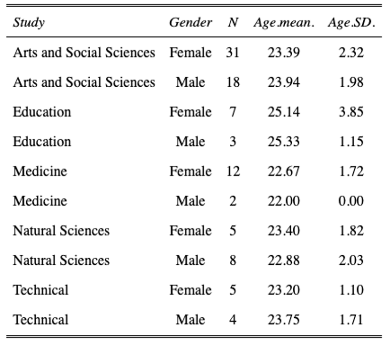{width="100%"}
:::
::: {.column width="50%"}
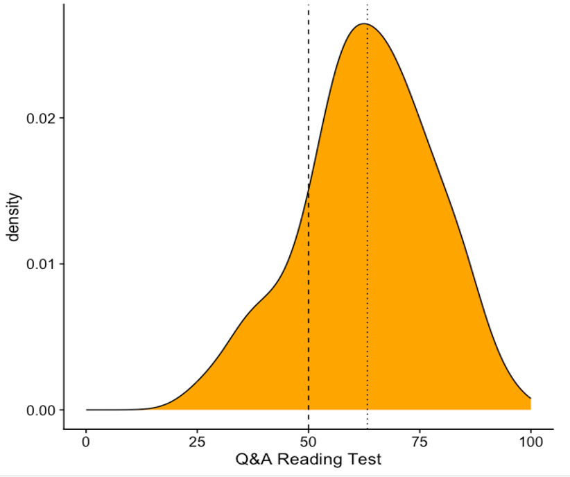{width="100%"}
:::
::::

## My attempt 1

:::: {.columns}
::: {.column width="50%"}
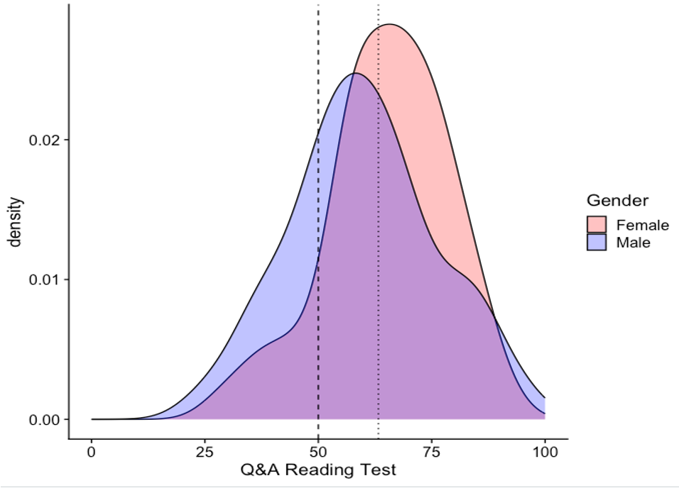{width="100%"}
:::
::: {.column width="50%"}
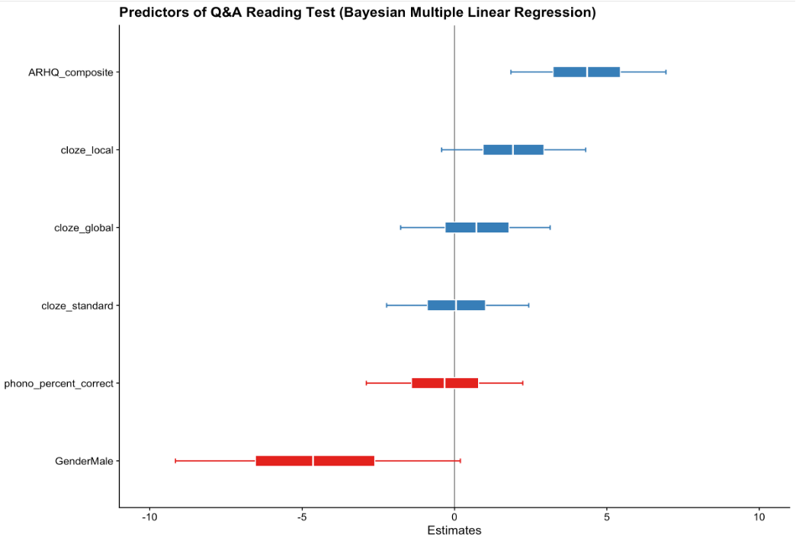{width="100%"}
:::
::::


## Meta-analysis

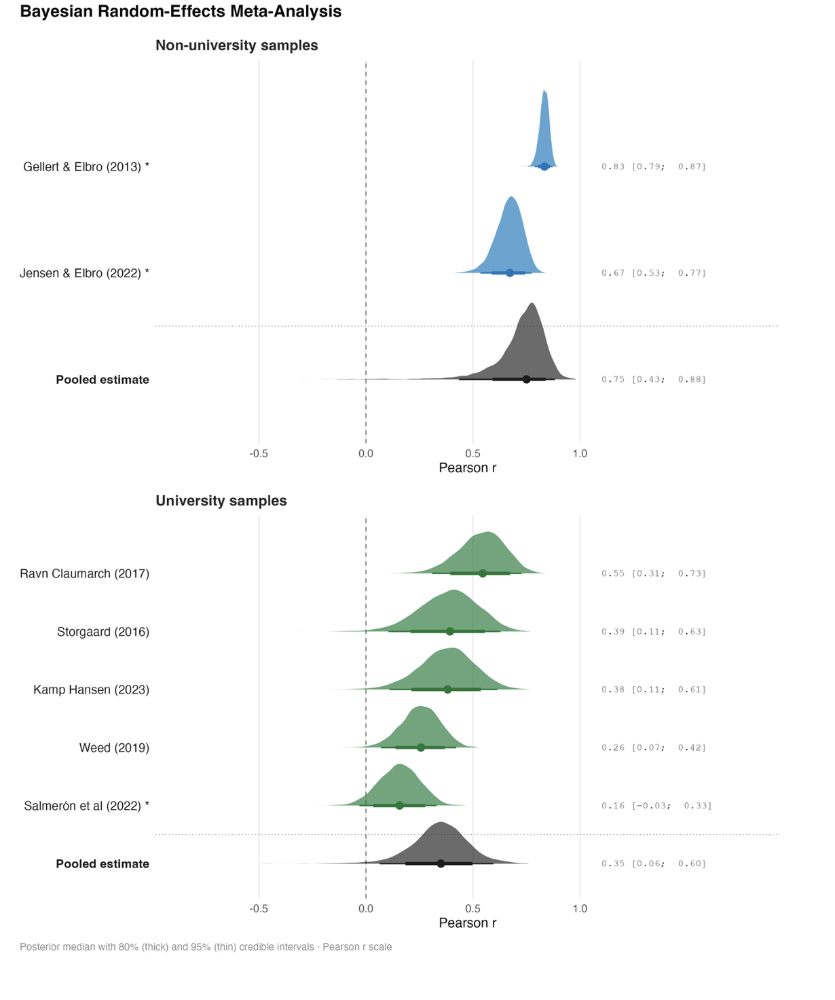{height="560px"}

## One more try

:::: {.columns}
::: {.column width="50%"}
::::: {style="font-size:0.75em"}
> Universal human rights are the foundation of individual freedom and human dignity. The protection of these rights is essential to prevent any form of ____ and to promote a just and equal social order.

confusion / influence / oppression / isolation
:::::

[@larsenUnpublished2025]{.caption}
:::
::: {.column width="50%"}
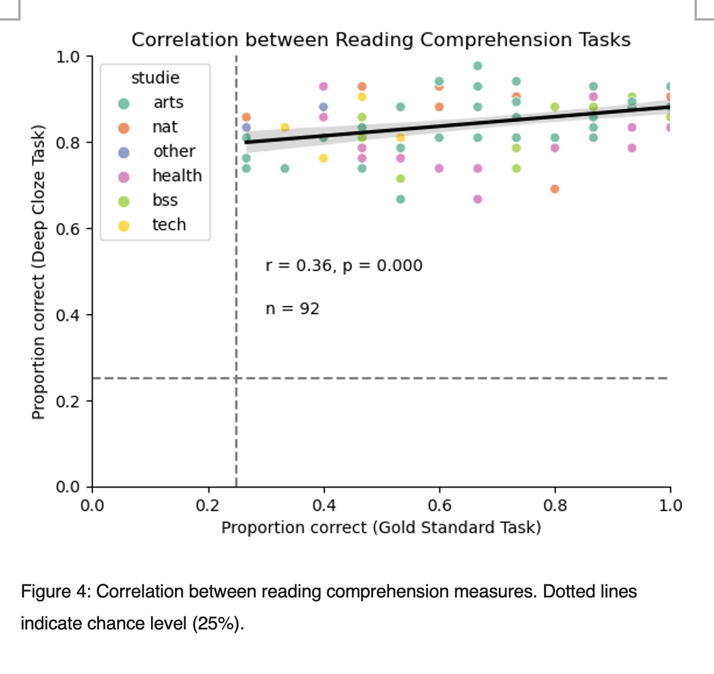{width="100%"}

[@weedInPreparation]{.caption}
:::
::::

# References

## References {.scrollable}

::: {#refs}
:::
